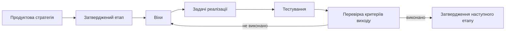

# Процес розробки

Статус: **запропоновано** · Дата: 2026-11-20
Пов'язані: [product-roadmap.md](product-roadmap.md) · [product-principles.md](product-principles.md) · [decisions.md](decisions.md) · [product-metrics.md](product-metrics.md)

## 1. Робочий процес

| Крок | Результат | Затвердження власником |
|---|---|---|
| Продуктова стратегія | Ця папка (`docs/product/`) | Так — один раз, далі при змінах |
| Затверджений етап | Етап позначено «Затверджено» в [product-roadmap.md](product-roadmap.md) + запис у [decisions.md](decisions.md) | **Так** |
| Віхи | 3–5 віх для затвердженого етапу, кожна — придатний вертикальний зріз із «готово, коли» | Так |
| Задачі реалізації | Задачі **лише для поточної віхи**, кожна з посиланням на розділ специфікації і кадр вайрфрейму | Ні (команда) |
| Тестування | Юніт-тести (кейси розрахунку з `calculation-model.md` §7 і `calculation_reference.py`), UI-тести шляхів, ручна перевірка на пристрої | Ні |
| Перевірка | Метрики проти критеріїв виходу; якісні висновки | **Так** (ворота етапу) |

## 2. Правила

1. **Ніколи не реалізовувати всю дорожню карту одразу.** Один етап за раз; одна віха в роботі за раз.
2. **Задачі реалізації є лише для затвердженого етапу.** Майбутні етапи описуються продуктовою мовою (результати, функції, метрики).
3. **Вайрфрейми — референс дизайну.** Реалізація йде за кадрами й специфікаціями; відхилення потребують запису UX-зміни.
4. **Жодної нової функціональності без оцінки бізнес-цінності** — фільтр функцій у [product-principles.md](product-principles.md) §3, із записом у [decisions.md](decisions.md).
5. **Документи йдуть за рішеннями.** Коли рішення змінюється, оновити специфікацію-власника і журнал рішень в одній зміні.
6. **Дефекти безпеки й конфіденційності блокують реліз** незалежно від етапу.

## 3. Як проходять зміни дизайну (наявний процес проєкту — зберегти)

У репозиторії вже є робочий конвеєр «специфікація → вайрфрейм» у `.claude/skills/`:

| Потреба | Навичка | Артефакти |
|---|---|---|
| Описати / змінити поведінку | Редагувати специфікацію в `docs/uk/...` | `<spec>.md` |
| Перевірити, що специфікація повна і готова до Figma | `requirements-validator` | `<spec>.validation.md` (RV-xxx) |
| Згенерувати / оновити кадри | `figma-wireframe-generator` | Сторінки Figma, `<spec>.wireframes.md` |
| Змінити наявний екран | `ux-wireframe-refiner` | `<spec>.ux-changes.md` (UXC-xx), потім оновлення специфікації |

Використовувати той самий конвеєр для відсутніх елементів MVP (налаштування, «Сьогодні» без норми, згода) і для дрібних правок із [mvp-scope.md](mvp-scope.md) §2.2 — **після** затвердження власником.

## 4. Означення

**Definition of Ready (задача)** — є посилання на розділ специфікації і кадр; критерії приймання; перелік подій аналітики; відкриті питання вирішено або є значення за замовчуванням.
**Definition of Done (задача)** — відповідає кадру і специфікації; стани (порожньо, завантаження, помилка, офлайн) оброблено; тести проходять; події надсилаються; повторний запис за 3 натискання не зламано.
**Definition of Done (віха)** — твердження «готово, коли» продемонстровано на пристрої; відомі проблеми перелічено.
**Ворота етапу** — представлено докази виконання критеріїв виходу; власник фіксує в [decisions.md](decisions.md): затвердити / продовжити / змінити курс.

## 5. Контроль змін для нових ідей
1. Сформулювати ідею як проблему + докази + очікувану зміну метрики.
2. Пропустити через фільтр функцій.
3. Класифікувати (Ядро / Утримання / Монетизація / Зростання / Було б добре мати) і призначити етап у [product-feature-map.md](product-feature-map.md).
4. Якщо це змінює поточний етап — потрібне затвердження власником; інакше ідея чекає на планування свого етапу.

## 6. Наведення ладу перед Етапом 1
- Закомітити поточну робочу копію `docs/uk/` (10 змінених файлів специфікацій не закомічено).
- Повторно запустити `requirements-validator` для `core-calorie-tracking-flow.md` (RV-006 очікує після зміни з панеллю вкладок).
- Власник підтверджує або заперечує рішення, запропоновані автором (D1–D13 онбордингу, PR-D5–PR-D12 Прогресу).
