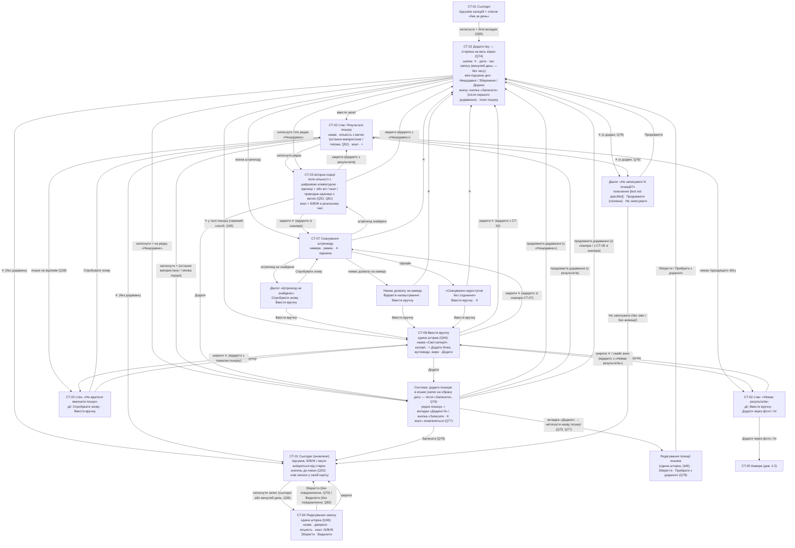
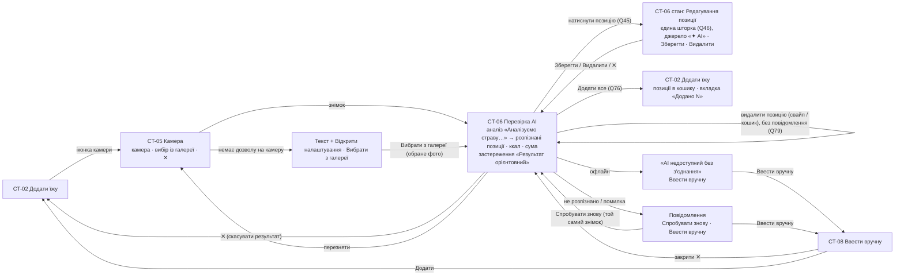

# Базовий потік обліку калорій — специфікація (чернетка для перегляду)

Статус: **чернетка; рішення D1–D7 і прийняті рішення власника продукту з §6 затверджені; відкриті питання Q5, Q6 очікують рішення.** Вайрфрейми — Figma, див. `core-calorie-tracking-flow.wireframes.md`.
Основа: `docs/uk/research/` (BitePal, Lifesum, MyFitnessPal на Mobbin).

## 1. Принципи дизайну (з дослідження)

1. **Пошук на першому місці, з вкладкою «Нещодавнє» як вмістом за замовчуванням.** Так роблять усі три застосунки; це найшвидший шлях для повторюваних продуктів.
2. **Швидке додавання одним натисканням з будь-якого рядка списку**, з вбудованим ✓ (MFP, Lifesum); результат видно на ✓, у вкладці «Додано» і на кнопці «Записати», без повідомлень (Q77).
3. **Редагування порції в шторці знизу з одним елементом керування і перемикачем одиниць** (BitePal), а не повноекранна форма (MFP).
4. **Без прийомів їжі: запис — це просто їжа за день** (рішення Q42; один список, як у Cal AI, BitePal, MacroFactor).
5. **Залишатися на екрані додавання, доки користувач не закінчить**, з бігучою сумою на кнопці «Записати · K ккал» і числом у вкладці «Додано» (Q77; ідея — панель BitePal + залишення на пошуку MFP).
6. **Без проміжних екранів після логування.** Користувач одразу повертається на оновлений головний екран (виключено звіт і серії BitePal).

## 2. Узгоджений потік

### 2.1 Основний шлях

### 2.2 Шлях фото / AI (входить у MVP, рішення Q8)

### 2.3 Покроково

| №   | Екран            | Дія користувача                                                 | Реакція системи                                                                                                  | Потрібна інформація                                |
| --- | ---------------- | --------------------------------------------------------------- | ---------------------------------------------------------------------------------------------------------------- | -------------------------------------------------- |
| 1   | CT-01 Сьогодні   | Бачить залишок ккал; натискає **+** біля вкладок                    | Відкриває CT-02                                                                                                  | Денна ціль, спожито, залишок, список їжі за день |
| 2   | CT-02 Додати їжу | Бачить «Нещодавнє»; натискає **+** на «Грецький йогурт»              | Додає в кошик останню використану порцію (а якщо її немає — типову); рядок ✓; вкладка «Додано 1»; кнопка «Записати · 120 ккал» | Назва продукту, ккал, порція (остання використана / типова) |
| 3   | CT-02            | Вводить «банан»                                                 | Результати оновлюються під час введення (з затримкою)                                                            | Запит                                              |
| 4   | CT-02 результати | Натискає рядок «Банан»                                          | Відкриває шторку CT-03 над результатами                                                                          | —                                                  |
| 5   | CT-03 Порція     | Обирає одиницю «г» і друкує «150» у полі кількості                | ккал і Б/В/Ж перераховуються в реальному часі                                                                    | Кількість, одиниця                                 |
| 6   | CT-03            | Натискає **Додати · 134 ккал**                                  | Шторка закривається; рядок ✓; вкладка «Додано 2»; кнопка «Записати · 254 ккал»                                             | —                                                  |
| 7   | CT-02            | Натискає **Записати**                                             | Повертається на CT-01                                                                                            | —                                                  |
| 8   | CT-01            | —                                                               | Число калорій анімується до нового значення; у кінці списку 2 нові позиції, разом 254 ккал                                    | —                                                  |

**Стан завершення:** користувач на CT-01 «Сьогодні». Спожите і залишок оновлені, а список «Їжа за день» показує нові записи, кожен з яких можна редагувати.

## 3. Ключові UX-рішення

### D1. Прийом їжі — до чи після продукту?

**Рішення (Q42): прийомів їжі немає.** Запис — це продукт на дату; CT-01 показує один список «Їжа за день» у порядку додавання, CT-02 і CT-03 не мають вибору прийому.

### D2. Вибір продукту і кількості: окремі екрани чи один?

**Рішення: один інтерфейс. Кількість — шторка знизу над результатами пошуку (CT-03).**

- Шторка BitePal зберігає результати видимими, тож закриття повертає точно на ту саму позицію прокрутки. Lifesum і MFP відкривають повні екрани.
- **Одне поле кількості з цифровою клавіатурою плюс одиниці** (природна одиниця продукту з вагою, г або мл, **ккал** — Q52) замість двох полів MFP; степпера «±» немає — 180 г друкують, а не натискають (рішення Q47).
- Основна кнопка несе результат: **«Додати · 134 ккал»** (патерн BitePal «Log 390 kcal»).

### D3. Кілька продуктів за одну сесію?

**Рішення: так. Позиції збираються в кошик на сторінці «Додати їжу» і записуються кнопкою «Записати · K ккал» (Q76); кількість — у вкладці «Додано» (Q77).**

- Кошик (BitePal «Log 390 kcal», MacroFactor «Log Foods») дає однозначні «записати» і «вийти без запису»; незаписаний кошик зберігається як чернетка, тож нічого не втрачається, якщо застосунок згорнули (Q76).
- Бігучий підсумок: кнопка «Записати · K ккал» і число у вкладці «Додано» (Q77; ідея — з панелі BitePal) дають видимість пакетного режиму без додаткового кроку підтвердження.
- Помилки покривають ✓ (прибирає позицію) і вкладка «Додано» (Q75, Q77).

### D4. Повертатися на головний екран після кожної позиції?

**Рішення: ні.** Залишатися на CT-02 після кожного додавання (усі три застосунки дозволяють продовжувати). Повертатися на головний екран лише при **Записати** або ✕ (без запису; Q76). Користувач з однією позицією робить одне зайве натискання («Записати»), і це прийнятно. Два розглянуті альтернативи:

- Автоматичне повернення після однієї позиції: погіршує додавання кількох продуктів поспіль.
- Підказка «Записати» після першого додавання: винесено як відкрите питання Q6.

### D5. Мінімізація взаємодій

- «Нещодавнє» — вміст за замовчуванням на CT-02 (усі три).
- Швидке + на кожному рядку (усі три) додає останню використану порцію, а якщо її немає — типову. **Остання використана порція** — рішення власника (Q17); жоден з застосунків явно її не показує.
- Прийом їжі не обирається (D1, Q42).
- Без проміжних екранів після логування (виключено звіт і серії BitePal).
- Автофокус пошуку **не** за замовчуванням, щоб «Нещодавнє» залишалося видимим; дотик до поля пошуку відкриває клавіатуру. Див. Q5.

### D6. Суттєва та другорядна інформація

| Суттєве (завжди видно)                                                                | Другорядне (на вимогу / пізніше)                                       |
| ------------------------------------------------------------------------------------- | ---------------------------------------------------------------------- |
| Головний екран: спожито, ціль, **залишок**, прогрес; список «Їжа за день» з ккал кожної позиції | Спалені / вправи, серії, вода, голодування                             |
| Результати: назва, порція (остання використана / типова), ккал (позначки перевірки немає до OQ-03, Q78) | Деталі бренду, оцінка продукту, «Best Match» (розглянути)              |
| Порція: кількість, одиниця, ккал в реальному часі, Б/В/Ж у грамах                     | Повні харчові факти, % від денної норми, кілька днів, звіт про продукт |

### D7. Найшвидший шлях для користувача, який повертається

**Сьогодні → + (кругла кнопка біля вкладок, Q65) → + на рядку «Нещодавнє» → Записати = 3 натискання** без введення тексту. Це збігається з найшвидшим спостереженим шляхом у MFP і Lifesum.

## 4. Перелік екранів

| ID        | Екран                          | Призначення                                                            | Точка входу                 | Основні компоненти                                                                                                                                                                                                                                                | Основна дія                     | Другорядні дії                                                                        | Стани                                                                                                                                                                                               | Переходи                                         |
| --------- | ------------------------------ | ---------------------------------------------------------------------- | --------------------------- | ----------------------------------------------------------------------------------------------------------------------------------------------------------------------------------------------------------------------------------------------------------------- | ------------------------------- | ------------------------------------------------------------------------------------- | --------------------------------------------------------------------------------------------------------------------------------------------------------------------------------------------------- | ------------------------------------------------ |
| **CT-01** | Сьогодні (денний огляд)        | Показати денний прогрес калорій і записану їжу; почати логування   | Запуск застосунку  | Заголовок дати без стрілок (Q56): сьогодні — «Сьогодні, 18 листопада», інший день — «Вівторок, 17 листопада» і під ним посилання «Сьогодні» (повертає на поточний день); без ⚙ (Q44); під ним — **стрічка тижня** (Q43): 7 днів пн–нд того тижня, де відкритий день, у кожному підпис дня, мале кільце і **число дня всередині кільця** (Q56) калорій дня за тими самими правилами форми, що й велике кільце (Q33: частка від ціль + 100 — повне лише на ціль + 100, Q61; понад план — повне коло і нейтральний бейдж «+» угорі праворуч, Q58); день без записів — пунктирне коло, майбутній — порожнє коло, без норми (Q38) — суцільне тонке коло з числом («записано»); відкритий день виділено; **підсумок калорій** (Q50): велике число спожитого і «з {ціль} ккал · план до {ціль + 100}» (Q62 — пояснює, чому смуга повна лише на ціль + 100); праворуч «{залишок} залишилось» (спожито ≤ ціль) або «+N понад план» (> ціль + 100); у межах плану (ціль < спожито ≤ ціль + 100) праворуч нічого — про це каже смуга (Q59); смуга спожитого — частка від ціль + 100 (Q61: 1 290 з 1 850 → 70 %; повна лише на ціль + 100), без пунктирної зони, штрихування і підпису «план …»; **Б/В/Ж з нормою (Q54)** (є записи без Б/В/Ж — Q78: суми лише за відомими записами, під смужками нейтрально «Без Б/В/Ж: {n} запис(и) · {K} ккал», дотик → той запис; без кольору й оцінок; у «Прогресі» такий день виключено із середнього Б/В/Ж, M-12): для кожного — назва, спожиті грами і поруч норма через «/» («52 г / від 65 г» · «151 г / 197–263 г» · «41 г / 39–68 г»; своя — «/ 120 г»), смужка — частка від верхньої межі норми (білки — від нижньої «від 65 г»), повна на межі, понад верхню межу — повна і «+N г» біля назви (Q61), без пунктирної зони; без кольору, оцінок і «перебору»; список «Їжа за день» (**без видимого заголовка і без суми за день** — Q55; для VoiceOver — заголовок «Записи»; позиції згруповано в **картки за часом** — Q49: заголовок групи стоїть **над карткою** на фоні сторінки (Q63): час першого запису (15 pt, напівжирний) і праворуч сума ккал групи («500 ккал», звичайна вага, сіра — Q62); у картці лише записи, у рядках — тільки число ккал («380»); сума і ккал рядків — в одній правій колонці з цифрами однакової ширини; лівий край часу — на одній лінії з назвами, «8:40 · 420 ккал»; запис, доданий менш ніж через 60 хв після попереднього, потрапляє в ту саму картку; рядки «назва · кількість · знак джерела · ккал», Q42, Q46; кількість — обрана одиниця з вагою, напр. «1 шт. (118 г) · ✎», для своїх калорій — без кількості, Q52; знак — лише іконка: ✎ (свої калорії), ▥ (штрихкод) або бейдж «AI»; продукт з пошуку, «Нещодавнє» чи «Збережене» — без знака (Q83); мітка доступності — словами, Q51); свайп уліво по запису → «Видалити» з «Скасувати» (Q64); нижня панель у стилі iOS 26 (Q65): плаваюча «таблетка» з вкладками «Сьогодні / Прогрес» (активна вкладка — власна підкладка) і праворуч окреме кругле **+** — єдиний вхід у додавання (Q65, PR-D3)                                      | **+ (додати їжу)**              | натиснути день у стрічці тижня → цей день (майбутній — лише перегляд, Q43); свайп по стрічці вправо / вліво → попередній / наступний тиждень, відкривається той самий день тижня (не далі за сьогодні, Q56); «Сьогодні» під заголовком → поточний день; повторне натискання вкладки «Сьогодні», коли вона вже відкрита, → поточний день (Q57); повернення в застосунок через ≥ 60 хв або після зміни календарного дня → поточний день (Q57); давніші дні — також через «Прогрес» → «Дописати їжу»; вкладка «Прогрес» → PR-01 (`../features/progress/requirements.md`, PR-D3); на минулих днях — так само, як сьогодні: **+** видимі, позиції відкривають CT-04, їжа додається на обрану дату (рішення Q36); майбутні дні — лише перегляд, **+** приховані; натиснути позицію → редагувати                       | Повернення після «Записати» (Q53, Q76; після ✕ / «Не записувати» — без змін і без анімації): екран відкривається з попередніми значеннями, і за ~0,6 с спожите, Б/В/Ж і смуги збільшуються, «залишилось» зменшується, нові записи з'являються у своїй картці й коротко підсвічуються; Зменшення руху — нові значення одразу; порожній день (нульовий стан; на місці карток — статична заглушка: пунктирна картка з сірими смужками і текстом «Тут з'являться записи за день», без мерехтіння і без кнопок, Q60); перший запуск (та сама заглушка + одна підказка біля «+» «Натисніть +, щоб записати першу їжу →» без затемнення; зникає назавжди після першого запису, Q60); інший день без записів (підсумок 0 ккал, текст «Немає записів за цей день»); частковий; у межах плану (спожито > ціль, але ≤ ціль + 100: смуга ще не повна — 1 790 → 97 %, праворуч нічого, Q61, Q31, Q33, Q50, Q59); понад план (> ціль + 100: смуга повна, Q61, праворуч «+N понад план», без червоного; рядка-пояснення під підсумком немає — Q59, Q32, Q33); повернення після перерви (≥ 2 дні без записів: банер «Раді бачити! Почнімо з сьогодні.» з ✕, Q32); без норми (Q38: онбординг завершено через ON-11 або норму вимкнено правилом безпеки в налаштуваннях — підсумок без смуги, цілі, залишку й коридору: лише «Спожито {N} ккал» (пояснення — у «Мій план» ST-02.S3, Q62); текстів Q32 про план немає; Б/В/Ж — лише грами; список їжі, **+**, редагування — як завжди); дописування минулого дня з «Прогресу» (відкрито кнопкою «Дописати їжу»: дата в заголовку, під ним підказка «Допишіть, що не записали за {день}. Їжа додасться в цей день.» з кнопкою «Готово» → назад у «Прогрес»; рішення PR-D23 у `features/progress/requirements.md`); завантаження                                                                  | CT-02, CT-04, PR-01                       |
| **CT-02** | Додати їжу (пошук + Нещодавнє)    | Знайти продукти і додати їх до обраного дня                            | CT-01 кругла + біля вкладок (Q65) | **Сторінка на весь екран (Q74)**: відкривається після «+» поверх CT-01 як окреме вікно; закривається ✕ (кругла світла кнопка 36 pt ліворуч у шапці, стиль iOS 26 — Q68) або «Записати»; ✕ — вийти без запису: без доданого закриває одразу, з доданим питає «Не записувати N позицій?» — «Продовжити» (головна) / «Не записувати» (Q76). Шапка (Q74): ✕ · **дата дня запису** — той самий формат і шрифт, що в заголовку CT-01 (Q56): «Сьогодні, 18 листопада» / «Вівторок, 17 листопада»; під датою сірим дрібно — сьогодні іконка годинника і поточний час «19:35» (оновлюється щохвилини; запис отримує час натискання «+», Q49; це текст, не кнопка — змінити час не можна; VoiceOver — «Час запису 19:35»), минулий день — «Дописуєте в цей день · без часу» (дописане йде в картку «Дописано» без часу, Q49; поточний час минулого дня не підставляється); перемкнути день на сторінці не можна — закрити → день у стрічці → «+» (Q36, Q73). Порція CT-03, редагування CT-04 (з вкладки «Додано») і «Ввести вручну» CT-08 відкриваються однією шторкою над сторінкою — шторки в шторці немає (Q74; Apple HIG — одна шторка за раз); список доданого — вкладка «Додано», не шторка (Q77). Під шапкою — **міні-підсумок дня** (Q71: компактна версія підсумку CT-01, ті самі правила Q61, Q62): велике число спожитого, «з {ціль} ккал · план до {ціль + 100}», праворуч «{N} залишилось» (спожито ≤ ціль), нічого (ціль < спожито ≤ ціль + 100 — Q59; на минулому дні — Q62) або «+N понад план»; смуга — частка від ціль + 100, без кольору; без норми (Q38) — лише «Спожито {N} ккал», без смуги; оновлюється одразу після «+», зміни чи видалення (Q69); сегментований перемикач **Нещодавнє / Збережене / Додано {N}** (Q77: третя вкладка — лише додане в цій сесії, ті самі рядки з ✓ і назвою, Q75; число N — у нейтральній «таблетці» у вкладці, з'являється після першого додавання; VoiceOver «Додано, N позицій»); рядки списку (назва, кількість у природній одиниці з вагою, Q52 — остання використана, а для нового продукту типова, ккал за цією порцією, **+**); унизу (Q77): **кнопка «Записати · {K} ккал»** на всю ширину (Q76: записує весь кошик і закриває сторінку) — K = сума саме цього додавання (Q67, Q70); з'являється після першого додавання; окремого лічильника немає — кількість у вкладці «Додано» (Q77); **поле пошуку** (Q67, S1): «таблетка» «Знайти їжу» і поруч три круглі кнопки 50 pt (нижній край ряду — на рівні «таблетки» вкладок CT-01, Q67) — ✎ «Ввести вручну» (CT-08), ▥ штрихкод (CT-07), 📷 фото / AI (CT-05) (Q45); натискання на поле — воно розширюється на всю ширину, кнопки ховаються, з'являється круглий ✕ («скасувати пошук» — кнопки повертаються), поле піднімається над клавіатурою; закріплене внизу екрана, під кнопкою «Записати» (рішення Q30, Q77) | **+ швидке додавання** на рядку | Натиснути рядок → CT-03; перемкнути вкладку; натиснути ✎ → CT-08 «Ввести вручну»; натиснути вкладку «Додано» → лише додане в цій сесії (Q77): ✓ прибирає позицію, дотик по назві — шторка порції в режимі редагування (Q75); на сторінці «Додати їжу» повідомлень «Додано / Прибрано · Скасувати» немає — результат видно на ✓, у вкладці «Додано {N}» і на кнопці «Записати» (Q77) | «Нещодавнє» заповнено; **перше використання (немає недавніх)**: текст-підказка «Тут з'являтимуться продукти, які ви записуєте. Знайдіть першу їжу через пошук унизу.» (Q41); «Збережене»: збережені продукти (ті самі рядки, що в «Нещодавнє»), порожнє — текст-підказка «Збережених продуктів ще немає. Додайте продукт зі шторки порції.» (Q41); введення / завантаження (поле пошуку над клавіатурою, кнопка «Записати» прихована, доки відкрита клавіатура; запит зберігається — Q30); результати; **немає результатів** (дії: «Ввести вручну» → CT-08; «Додати через фото / AI» → CT-05); рядок додано (✓; Q75, Q77: дотик по ✓ прибирає позицію з кошика без повідомлення — повернути можна знову «+»; дотик по назві доданого продукту — та сама шторка порції в режимі редагування з поточною кількістю, «Зберегти» / «Прибрати з доданого» (Q78); одна позиція на продукт за сесію — дві порції задають кількістю); офлайн («Нещодавнє» / «Збережене» і «Ввести вручну» працюють; пошук недоступний, у полі пошуку повідомлення «Пошук недоступний без з'єднання»; сканування штрихкоду і фото/AI недоступні — повідомлення на CT-07 / CT-06); діалог виходу (Q76: ✕ з доданим — «Не записувати N позицій?» · «Продовжити» (головна, повертає на сторінку) · «Не записувати» (закриває без запису → CT-01 без змін і без анімації); текст пояснення — [text not specified]); чернетка (незаписаний кошик зберігається, якщо застосунок згорнули чи закрили; наступне «+» на той самий день відкриває сторінку з тими самими позиціями, Q76); вкладка «Додано» (Q85: є завжди; число в «таблетці» — від першої позиції; без позицій — [text not specified]; кнопка «Записати» зникає, коли кошик порожній); **помилка пошуку** (Q39: з'єднання є, але пошук не відповів — замість списку «Не вдалося виконати пошук» і дії «Спробувати знову» (повторює той самий запит) · «Ввести вручну» → CT-08; запит у полі зберігається; кошик не змінюється) | CT-03, CT-01 (Записати / ✕), CT-05, CT-07, CT-08 |
| **CT-03** | Шторка порції (шторка знизу)   | Встановити кількість і одиницю, побачити харчову цінність, підтвердити | Натискання рядка на CT-02; знайдений штрихкод на CT-07 | **Єдина шторка позиції (Q46)** — однакова для пошуку, «Нещодавнє», «Збережене», штрихкоду, AI і введення вручну, для додавання і редагування: назва; **шапка** (Q78): ручка · ✕ ліворуч · назва по центру з ✎ поруч (Q80: ✎ видно завжди; активний — свої калорії, AI, продукт у «Збережене»; неактивний — продукт з бази, дотик показує під назвою «Назва з бази. Щоб назвати по-своєму, додайте в Збережене ☆»; редагування — назва стає полем у шапці, звичайна клавіатура, до 60 символів, лічильник з 50-го, зберігається разом із «Додати» / «Зберегти») · ☆ / ★ «Додати у Збережене» праворуч; **рядок джерела** лише там, де він щось змінює (Q78): «▥ штрихкод», «✎ свої калорії», «AI · оцінка орієнтовна»; для продукту з пошуку, «Нещодавнє», «Збережене» — без рядка; «✓ перевірений продукт» не показується до рішення про базу продуктів (OQ-03); **поле кількості** (велике число й одиниця; натискання відкриває цифрову клавіатуру; «±» немає, Q47); **одиниці** чіпами (Q52): «г» (або «мл» для рідин) · «ккал» · природна одиниця продукту з вагою (порядок Q81; «шт. (118 г)», «скибка (30 г)», «склянка (250 мл)»; «порція» — лише якщо база дає тільки її, і з вагою: «порція (280 г)»); усі одиниці показано, недоступні для джерела — неактивні (Q79): для AI «шт.» неактивна, активні «г · ккал»; для своїх калорій «шт.» і «г» неактивні, обрано «ккал» — людина друкує калорії, кількість перераховується; друге значення — у полі кількості праворуч, сірим: «= 134 ккал» (ввели г або природну одиницю) / «≈ 150 г» (ввели ккал), окремого великого числа під полем немає (Q81); **білки · вуглеводи · жири** — три колонки з повними словами, цілі грами, «<1 г» замість «0 г», лише для перегляду (Q47, Q81); для своїх калорій — у полі нічого праворуч, під одиницями «+ Додати білки, вуглеводи, жири» (необов'язкові поля); підказка під полем — лише «Введіть кількість більше 0» при некоректній кількості (Q81); основна **Додати · N ккал** на всю ширину (сума — реальна); у режимі редагування — **Зберегти · N ккал** і під нею текстова кнопка: «Прибрати з доданого» (кошик на CT-02, Q76) або «Видалити» (записаний запис на CT-01, CT-06), Q78; якщо в базі немає Б/В/Ж — рядок «Білки, вуглеводи, жири — немає даних» замість нулів (Q78, Q81) | **Додати**                      | ☆ у шапці — «Додати у Збережене» (Q78) | Типова порція; введення кількості (цифрова клавіатура, шторка над нею, ккал і Б/В/Ж оновлюються під час введення, Q47); введено ккал (у полі праворуч «≈ N г», Q81); Б/В/Ж немає даних («Білки, вуглеводи, жири — немає даних», Q78); свої калорії (обрано «ккал», «шт.» і «г» неактивні, «+ Додати білки, вуглеводи, жири», Q79, Q81); змінено; некоректно (0 / порожньо → кнопка вимкнена, підказка «Введіть кількість більше 0», Q81)                                                                                                                                 | CT-02 (після Додати; закрити — якщо відкрито з CT-02); CT-07 (закрити — якщо відкрито зі сканера) |
| **CT-04** | Редагування запису             | Змінити або видалити будь-яку позицію                                  | Натискання позиції на CT-01; натискання назви позиції у вкладці «Додано» CT-02 (Q77); натискання назви вже доданого продукту в списку CT-02 (Q75); натискання позиції на CT-06 (Q45) | Та сама єдина шторка, що й CT-03 (Q46), у режимі редагування — для будь-якого джерела однаково: назва, знак джерела, поле кількості й одиниці (зокрема «ккал»), підсумок ккал і Б/В/Ж для перегляду (Q47), «Додати у Збережене»; кнопки **Зберегти · N ккал** і текстова **Видалити** (запис на CT-01) або **Прибрати з доданого** (кошик CT-02), Q78                                                                                                                                                                                                                           | **Зберегти**                    | **Видалити** (без повідомлення, Q82); після **Зберегти** — без повідомлення (Q79)                                        | Редагування (продукт / введено вручну / AI); збережено (нові значення одразу, без повідомлення, Q79); видалено (запис зникає, без повідомлення, Q82) | CT-01 (відкрито з CT-01); CT-02 — той самий стан (відкрито з вкладки «Додано» або з назви доданого продукту в списку, Q75); CT-06 (відкрито з CT-06) — після «Зберегти», «Видалити» / «Прибрати з доданого» або ✕ |
| **CT-05**   | Камера       | Зняти фото страви для AI                                             | Іконка камери на CT-02    | Видошукач, затвор, галерея, закрити                                                                                                                                                                                                                             | Зняти                         | Галерея                                                                             | Немає дозволу на камеру (текст · «Відкрити налаштування» · «Вибрати з галереї» → CT-06); зйомка                                                                                                                                                                         | CT-06, CT-02                                   |
| **CT-06**   | Перевірка AI | Підтвердити виявлені позиції перед логуванням                        | CT-05                         | Список розпізнаних позицій (назва, грами, ккал; натискання позиції → редагування грамів і калорій, Q45; видалення свайпом або кошиком без повідомлення, Q79), сума ккал, застереження «Результат орієнтовний», ✕, Перезняти, **Додати все** (Q76)                                                                                                                                                           | Додати все                  | Змінити позицію; видалити позицію; перезняти; ✕ (скасувати результат); після «Додати все» — позиції в кошику CT-02 (вкладка «Додано N»)                                               | Аналіз («Аналізуємо страву…», ✕ скасування); результати; їжу не розпізнано / помилка (повідомлення «Не вдалося розпізнати страву. Спробуйте ще раз або введіть калорії вручну.» (Q41) з діями: «Спробувати знову» повторює аналіз того самого знімка; «Ввести вручну» → CT-08, ✕ → CT-06, Додати → CT-02); офлайн (повідомлення «AI недоступний без з'єднання» і дія «Ввести вручну» → CT-08; «Спробувати знову» немає)                                                                                                                                          | CT-02 (Додати все / ✕), CT-05 (Перезняти), CT-08 (з повідомлення про помилку)                                   |
| **CT-07**   | Сканування штрихкоду | Знайти продукт за штрихкодом | Іконка штрихкоду в полі пошуку CT-02 | Повноекранна камера з рамкою, ✕ зверху, підказка «Наведіть камеру на штрихкод» (Q41), індикатор «Пошук…» після розпізнавання | Сканувати | ✕; «Ввести вручну» (з діалогу, станів без камери і офлайн) | Сканування; «Пошук…»; знайдено; не знайдено (діалог «Штрихкод не знайдено» з діями «Спробувати знову» і «Ввести вручну»); немає дозволу на камеру (те саме, що на CT-05, але замість «Вибрати з галереї» — «Ввести вручну»); офлайн («Сканування недоступне без з'єднання» · «Ввести вручну» · ✕) | CT-03 (знайдено), CT-08 (з діалогу, станів без камери і офлайн), CT-02 (✕) |
| **CT-08**   | Ввести вручну (шторка знизу) | Окремий спосіб записати їжу: людина сама вводить калорії (Q45) | **✎ у полі пошуку CT-02** (основний вхід, Q45); також стан «Немає результатів» і стан помилки пошуку (Q39) на CT-02; діалог «Штрихкод не знайдено», стани без дозволу камери і офлайн на CT-07; повідомлення про помилку на CT-06 | Та сама єдина шторка, що й CT-03 (Q46), для нового продукту: на місці назви — поле з сірою підказкою «Свої калорії» (Q80), рядок джерела «✎ свої калорії» (Q78), одиниця «ккал» обрана, «шт.» і «г» неактивні (Q79), у полі кількості — калорії (обов'язкові), Б/В/Ж — за посиланням «+ Додати білки, вуглеводи, жири» (необов'язкові, Q47, Q81); **Додати · N ккал** | Додати | Закрити (✕ або свайп вниз) | Калорії порожні (**Додати** вимкнена); готово до додавання; назва введена → позиція підписується цією назвою; назва порожня → загальна назва «Свої калорії» (Q52; у вкладці «Додано» CT-02 і в списку їжі CT-01); у рядку — лише назва і ккал, без кількості; Б/В/Ж не введено → у «Прогресі» день без Б/В/Ж | CT-02 (після Додати: позиція потрапляє в кошик (вкладка «Додано»); закрити — у той стан CT-02, з якого відкрито); CT-07 (закрити — якщо відкрито зі сканера); CT-06 (закрити — якщо відкрито з помилки AI) |

**Кількість:** 3 основні екрани (CT-01, CT-02, CT-03), плюс 1 режим редагування, що використовує CT-03 (CT-04). Логування фото AI входить до MVP (рішення Q8): додаються 2 екрани (CT-05, CT-06). Сканування штрихкоду (Q8, Q19) додає екран CT-07, «Ввести вручну» (Q3, Q18, Q45) — шторку CT-08.

## 5. Деталі взаємодії

- **Повідомлення зі «Скасувати» (Q45, Q77, Q79, Q82, Q84):** на сторінці «Додати їжу» повідомлень немає — результат видно на ✓, у вкладці «Додано» і на кнопці «Записати» (Q77); після «Зберегти» і після видалення позиції на CT-06 повідомлень немає (Q79); після «Видалити» у шторці редагування на CT-01 повідомлення немає (Q82). Лишається лише «Видалено · Скасувати» після свайпу «Видалити» на CT-01 (Q64, Q84); триває близько 4 с, скасування повертає запис. Діалогів підтвердження немає (виняток — Q76: ✕ з доданим).
- **Кнопка «Записати» і вкладка «Додано» (Q67, Q76, Q77, Q85):** кнопка «Записати · K ккал» на всю ширину (K — сума цього додавання) з'являється після першого додавання і зникає, коли кошик порожній (Q85); одне натискання записує весь кошик і закриває сторінку (P1). Вкладка «Додано {N}» — третя в перемикачі, видима завжди; число в «таблетці» — від першої позиції (Q85). У ній лише позиції цієї сесії, ті самі рядки «назва · кількість · ккал» (Q52): ✓ прибирає позицію, дотик по назві відкриває шторку редагування (Q45, Q75; «Зберегти» / «Прибрати з доданого»); свайпу немає (Q84). Шторки списку позицій немає (Q77).
- **Перерахунок в реальному часі:** ккал = ккал на грам × грами (або на порцію × порції). Калорії округлюються до цілих ккал; білки, вуглеводи, жири — до цілих грамів, менше 1 г — «<1 г» (Q81).
- **Оновлення головного екрана:** при поверненні число спожитого анімується, а картка з новими записами (остання в списку) коротко підсвічується. Без спостережуваного прикладу це лише рекомендація щодо руху **[I]**.
- **Картки за часом у списку «Їжа за день» (рішення Q49):** застосунок сам ділить день на картки без назв прийомів. Записи йдуть за часом запису; запис, доданий менш ніж через 60 хв після попереднього, — у тій самій картці, інакше починається нова. Заголовок картки: час першого запису і сума ккал картки («8:40 · 420 ккал»); заголовка списку і суми за день немає (Q55). Їжа, дописана на минулий день (Q36), групується за сесією додавання (усе до «Записати» — одна картка) із заголовком «Дописано · {сума} ккал». Видалення / зміна запису перераховує суму картки; картка без записів зникає. Час — це час запису, не час їжі; перенести запис на інший час — поза обсягом.
- **Ввести вручну (окремий спосіб, рішення Q45):** повноцінний спосіб записати їжу поруч зі штрихкодом і фото — ✎ у полі пошуку CT-02. Входить у MVP (рішення Q3); шторка CT-08 (рішення Q18, поля доповнено Q45). Додатково у стані «Немає результатів» пропонується разом із додаванням через фото / AI; також доступне з діалогу «Штрихкод не знайдено», зі станів CT-07 без дозволу камери і офлайн та з повідомлення про помилку AI на CT-06.
- **Коридор і середнє за тиждень (рішення Q31, Q34):** норма показується як коридор «ціль ± 100 ккал» (правила — `calculation-model.md` §4.6). Поки спожите ≤ ціль, підсумок показує «{N} залишилось»; від цілі до цілі + 100 — праворуч нічого (Q59), без від'ємного залишку; понад ціль + 100 — «+N понад план» звичайним (не червоним) стилем. Рядка тижня на CT-01 немає (рішення Q48): тиждень видно в стрічці днів (Q43), а середнє за тиждень — у «Прогресі» (PR-01).
- **Анімація підсумку після «Записати» (рішення Q53, Q76):** коли людина повертається на CT-01 з CT-02 після «Записати» (після ✕ / «Не записувати» нічого не записано й анімації немає), «Сьогодні» спершу показує значення до сесії, а потім одним плавним рухом (~0,6 с, сповільнення наприкінці) доводить їх до нових: число «спожито» і смуга ростуть, «залишилось» зменшується, Б/В/Ж (числа й смуги) ростуть, сума картки і «Їжа за день» оновлюються, нові записи з'являються у своїй картці за часом і коротко підсвічуються; кільце сьогоднішнього дня в стрічці тижня оновлюється разом. Якщо значення перетинає ціль або ціль + 100, рух іде до нового стану без окремих ефектів: «залишилось» доходить до 0 і зникає (у межах плану) або змінюється на «+N понад план» (Q59), смуга доходить до кінця — без кольору, звуку, вібрації, конфеті й похвали (E11–E14). Анімація грає один раз; на відкритті застосунку, перемиканні днів і після редагування чи видалення на CT-01 не грає. «Скасувати» в повідомленні повертає значення тим самим рухом назад. Якщо в системі ввімкнено «Зменшення руху», нові значення з'являються одразу (без руху чисел; допустиме коротке перетікання). VoiceOver оголошує підсумок один раз після оновлення («Спожито 1 290 з 1 750 ккал, залишилось 460»), а не кожне проміжне число.
- **Смуга підсумку (рішення Q33, Q50):** колір смуги не змінюється в жодному стані. Шкала смуги — від 0 до ціль + 100 (Q61). Спожито ≤ ціль — смуга заповнюється пропорційно, праворуч «{залишок} залишилось». Ціль < спожито ≤ ціль + 100 — смуга ще не повна, праворуч нічого (Q59). Спожито > ціль + 100 — смуга повна, праворуч «+{спожито − ціль} понад план» (рахується від цілі, щоб збігатися з «з {ціль} ккал»; Q61). Сигнал передають заповнення смуги і текст, а не колір.
- **Без перенесення між днями (рішення Q34):** денна ціль не змінюється через попередні дні — ні надлишок, ні залишок не переносяться; середнє за тиждень (у «Прогресі» і в текстах Q32) — середнє, а не залишок бюджету; тексти ніколи не радять «з'їсти завтра менше».
- **Нейтральні тексти замість «зривів» (рішення Q32):** застосунок не визначає «зриви» і не використовує це слово. Тексти з'являються лише на CT-01 за сьогодні, лише в застосунку (без push), не більше одного на день:
  - день понад коридор — тексту під підсумком немає (Q59): стан видно зі смуги й «+N понад план»; тиждень — у «Прогресі»;
  - повернення після ≥ 2 календарних днів без жодного запису → банер над підсумком «Раді бачити! Почнімо з сьогодні.» з ✕; зникає після ✕ або першого додавання сьогодні; (один текст на день);
  - день без записів — «немає даних»: жодних висновків про їжу, не враховується в тижневому порівнянні й адаптивній моделі; частково записаний день — нічого не показуємо;
  - ніколи: push про перевищення, червоний колір, слова «перевищено» / «зрив», серії, що «згоряють», поради «з'їжте завтра менше».
  Вимкнення цих текстів у налаштуваннях — поза обсягом (у `settings.md` такого пункту немає).
- **Розташування (рішення Q30, Q65, PR-D3):** CT-01 — заголовок дати фіксований, контент прокручується, глобальна + — кругла кнопка праворуч від плаваючої «таблетки» вкладок «Сьогодні / Прогрес» (Q65, PR-D3). CT-02 — сторінка на весь екран (Q74), шапка (✕ · дата · час) і міні-підсумок дня під нею (Q71) фіксовані, список прокручується; поле пошуку закріплене внизу екрана, кнопка «Записати» — безпосередньо над ним (рішення Q30, Q77; повідомлень на сторінці немає). Поки відкрита клавіатура, поле пошуку розташоване над нею, а кнопка «Записати» прихована; після закриття клавіатури вона повертається з тією самою сумою.

## 6. Відкриті питання

| ID | Питання | Варіанти з документа | Пов'язано |
| --- | --- | --- | --- |
| Q5 | Автофокус пошуку на CT-02 | за замовчуванням вимкнено (D5), дотик відкриває клавіатуру | D5 |
| Q6 | Підказка «Записати» після першого додавання | див. D4 | D4 |

Примітка: формулювання Q1, Q2, Q4 у документі відсутнє; якщо такі питання існували, власнику слід їх відновити.

### Прийняті рішення власника продукту

| ID | Рішення |
| --- | --- |
| Q3 | «Ввести вручну» (свої калорії) входить у MVP (шторка CT-08 — Q18, Q45) |
| Q8 | Фото/AI (CT-05, CT-06) і штрихкод входять у MVP (екран штрихкоду CT-07 — Q19) |
| Q13 | Вкладка «Збережене» — збережені продукти; порожній стан — текст-підказка |
| Q14 | Офлайн: «Нещодавнє» / «Збережене» і «Ввести вручну» працюють, пошук недоступний з повідомленням |
| Q16 | D1–D7 затверджені |
| Q17 | Швидке «+» додає останню використану порцію, а якщо її немає — типову |
| Q18 | «Ввести вручну» — шторка CT-08 з полями «Калорії» (обов'язкове) і «Назва» (склад шторки — Q45, Q46); у стані «Немає результатів» пропонуються «Ввести вручну» і AI-фото |
| Q19 | Штрихкод — екран CT-07: знайдено → CT-03; не знайдено → діалог «Спробувати знову» / «Ввести вручну»; ✕ → CT-02 |
| Q21 | Минулі дні редагуються, майбутні — лише перегляд (Q36); день без записів — текст «Немає записів за цей день»; день обирається в стрічці тижня (Q56) |
| Q22 | Рядок списку показує порцію, яку додасть «+» (остання використана, інакше типова) |
| Q23 | Вкладка «Recent» називається «Нещодавнє» |
| Q24 | Фото/AI: CT-05 → CT-06 → «Додати все» — позиції йдуть у кошик CT-02 (Q76), повернення на CT-02; ✕ на CT-06 скасовує результат; позицію можна змінити (грами, калорії) або видалити без повідомлення (Q45, Q79) |
| Q25 | Стани CT-05/CT-06: немає дозволу на камеру; аналіз; не розпізнано / помилка / офлайн; застереження «Результат орієнтовний» |
| Q26 | Після «Додати» у CT-03, відкритій зі сканера, — CT-02; ✕ на CT-03 і CT-08, відкритих зі сканера, повертає на CT-07 |
| Q27 | «Спробувати знову» повторює аналіз того самого знімка; «Вибрати з галереї» → CT-06; «Ввести вручну» з помилки AI → CT-08 (✕ → CT-06, Додати → CT-02) |
| Q28 | CT-07 без дозволу камери — як CT-05 (замість галереї «Ввести вручну»); офлайн — «Сканування недоступне без з'єднання»; позиція CT-08 без назви підписується «Свої калорії» (Q52) |
| Q29 | Офлайн на CT-06: повідомлення «AI недоступний без з'єднання» і дія «Ввести вручну» (без «Спробувати знову») |
| Q30 | CT-02: поле пошуку (з кнопками ✎, штрихкоду і камери) закріплене внизу екрана, кнопка «Записати» — над ним (Q77), повідомлень на сторінці немає; поки відкрита клавіатура, поле над нею, кнопка «Записати» прихована й повертається з тією самою сумою; запит зберігається |
| Q31 | CT-01: коридор «ціль ± 100 ккал» (у межах плану — без від'ємного залишку, праворуч нічого, Q59; понад коридор — «+N понад план» без червоного). Рішення з онбордингу (D15) |
| Q32 | Застосунок не визначає «зриви»: лише нейтральний текст на CT-01 — банер після ≥ 2 днів без записів (тексту про день понад коридор немає — Q59), без push, один на день; день без записів — «немає даних». Рішення з онбордингу (D16) |
| Q33 | Понад план колір підсумку не змінюється: сигнал — заповнення смуги і текст «+N понад план», без червоного. Форма підсумку — Q50, Q61 |
| Q34 | Без перенесення між днями: денна ціль не залежить від попередніх днів; середнє за тиждень — середнє за день, а не залишок бюджету. Рішення з онбордингу (D17) |
| Q35 | Середнє калорій за тиждень рахує лише **повні** дні (до вчора), як середнє в «Прогресі» (одна метрика всюди); приховане, якщо повних днів менше 3 (`../features/progress/requirements.md` PR-D15). На CT-01 рядка тижня немає (Q48) — правило діє для «Прогресу» |
| Q36 | **Редагування минулих днів.** Їжу можна додавати, змінювати й видаляти на будь-який минулий день від початку обліку: на CT-01 переходять на день натисканням у стрічці тижня або свайпом на попередній тиждень (Q56), там **+** і натискання позицій (CT-04) працюють так само, як сьогодні; CT-02 додає їжу на обрану дату, і якщо це не сьогодні, у шапці CT-02 видно дату (формат — Q72). Майбутні дні — лише перегляд, **+** приховані. Після зміни минулого дня «Прогрес» перераховує цей день, а відповідь «Так, це все» / «Ні, не все» про нього знімається (`../features/progress/requirements.md` PR-D22) |
| Q38 | **«Сьогодні» без норми** (D20 онбордингу): CT-01 — підсумок без смуги, цілі, залишку й коридору, лише «Спожито {N} ккал» (пояснення — у «Мій план» ST-02.S3, Q62); Б/В/Ж — грами без цілей; решта CT-01 без змін. Режим вмикається, якщо онбординг завершено через ON-11 «Продовжити без норми» або правило безпеки спрацювало під час редагування в налаштуваннях (ST-02) |
| Q39 | **Помилка пошуку CT-02:** якщо з'єднання є, але пошук не відповів (таймаут, збій сервера) — стан «Не вдалося виконати пошук» з діями «Спробувати знову» і «Ввести вручну» (той самий патерн, що в CT-06 / CT-07); запит зберігається |
| Q40 | **«Більше харчової цінності» на CT-03 / CT-04 у MVP немає:** шторка показує ккал і Б/В/Ж; розширені нутрієнти — лише якщо з'являться в базі продуктів (OQ-03) і окремим рішенням |
| Q41 | **Тексти:** CT-02 перше використання — «Тут з'являтимуться продукти, які ви записуєте. Знайдіть першу їжу через пошук унизу.»; «Збережене» порожнє — «Збережених продуктів ще немає. Додайте продукт зі шторки порції.»; CT-07 — «Наведіть камеру на штрихкод»; помилка AI на CT-06 — «Не вдалося розпізнати страву. Спробуйте ще раз або введіть калорії вручну.» Порожній день на CT-01 — Q60 |
| Q42 | **Без прийомів їжі.** CT-01: один список «Їжа за день» без розділів Сніданок / Обід / Вечеря / Перекус (картки за часом — Q49; натискання позиції → CT-04); єдиний вхід у додавання — «+» (Q65). CT-02, CT-03 / CT-04: вибору прийому немає. Дані: у запису немає прийому. «Прогрес»: повнота дня — лише за калоріями (PR-D25, `../features/progress/requirements.md`) |
| Q43 | **Поточний тиждень на «Сьогодні»** (мета — людина бачить, що формує звичку і йде правильним шляхом). CT-01: під заголовком дати — стрічка тижня пн–нд з малим кільцем калорій кожного дня (правила форми — Q33, Q58, Q61; немає записів — пунктир; майбутній — порожнє; без норми — суцільне тонке коло з числом, «записано»); тап по дню відкриває його (минулі — як Q36, майбутні — лише перегляд); інші тижні — свайпом по стрічці (Q56). Без серій, вогників, «днів поспіль» і оцінок (E12) |
| Q44 | **⚙ на «Сьогодні» немає:** у заголовку CT-01 лише дата (Q56). Вхід у налаштування ST-01 — іконка ⚙ у заголовку «Прогрес» (PR-01 / PR-02) поруч з ⓘ (`../features/progress/requirements.md` PR-D26, `settings.md` ST-D5) |
| Q45 | **Змінити, видалити — на кожному етапі; «Ввести вручну» — окремий спосіб.** Будь-яку позицію можна відкрити й змінити: у вкладці «Додано» CT-02 (Q77), на CT-06 і на CT-01 — та сама шторка (Q46); для AI можна змінити й назву (Q80). Діалогів підтвердження немає, крім ✕ з незаписаними позиціями (Q76). Повідомлення зі «Скасувати» — лише після свайпу «Видалити» на CT-01 (Q64, Q84); після збереження, після видалення в шторці і на сторінці «Додати їжу» повідомлень немає (Q77, Q79, Q82). CT-08 називається «Ввести вручну»: основний вхід — ✎ у полі пошуку CT-02 поруч з камерою і штрихкодом (не лише після невдачі); поля «Калорії» (обов'язкове), «Назва», Б/В/Ж (необов'язкові). Доповнює Q18 |
| Q46 | **Одна шторка позиції і знак джерела.** Шторка додавання і редагування однакова для всіх способів (пошук, «Нещодавнє», «Збережене», штрихкод, AI, свої калорії): назва · знак джерела · кількість і одиниці · ккал і Б/В/Ж (Q47: поле кількості з клавіатурою, «ккал» як одиниця, Б/В/Ж лише для перегляду) · ☆ «Додати у Збережене» · «Додати · N ккал» або «Зберегти · N ккал» + «Видалити» / «Прибрати з доданого» (склад і кнопки — Q78). Знак джерела показує, як додано саме цей запис: у шторці — рядок джерела лише для штрихкоду, своїх калорій і AI, «✓ перевірений продукт» — до рішення OQ-03 (Q78); у списках — лише іконка (Q51) і лише для своїх калорій, штрихкоду й AI, продукт з бази — без знака (Q83). Знак — форма, не колір (E13). ✎ «Ввести вручну» на CT-02 лишається (Q45) |
| Q47 | **Кількість — одне поле з цифровою клавіатурою, «ккал» — одиниця, Б/В/Ж — для перегляду.** У єдиній шторці (Q46) немає «±»: натискання поля відкриває цифрову клавіатуру; одиниці — Q52, їхній порядок — Q81; обрано «ккал» — людина друкує калорії, кількість перераховується. Калорії і Б/В/Ж лише для перегляду — Б/В/Ж продукту вручну не редагуються. Свої калорії — та сама шторка з обраною «ккал»; Б/В/Ж — за посиланням «+ Додати білки, вуглеводи, жири» (необов'язково; без них день не входить у середні Б/В/Ж «Прогресу»). Підказки під полем немає, крім некоректної кількості (Q81); «Додати у Збережене» — ☆ у шапці (Q78). Посилання для Б/В/Ж — типове значення: власник не обрав між «за посиланням» і «немає» |
| Q48 | **Рядка тижня на «Сьогодні» немає.** Тиждень показує стрічка днів (Q43), середнє за тиждень — «Прогрес» (PR-01, правило Q35 / PR-D15) |
| Q49 | **Картки за часом у «Їжа за день».** Без назв прийомів: записи з різницею менше 60 хв — одна картка; заголовок «{час} · {сума} ккал» (вигляд — Q63); дописане на минулий день — за сесією, «Дописано · {сума} ккал»; заголовка списку і суми за день немає (Q55). Доповнює Q42 (один список). Поріг 60 хв — запропонований автором і прийнятий |
| Q50 | **Підсумок калорій — одне число і смуга.** Велике число спожитого «з {ціль} ккал»; праворуч одне допоміжне — «{N} залишилось», нічого (у межах плану, Q59) або «+N понад план»; смуга без червоного (шкала і вигляд — Q61). «Залишок» не повторюється двічі. Без норми (Q38) — лише «Спожито {N} ккал». Мале кільце дня в стрічці тижня (Q43) лишається кільцем |
| Q51 | **Знак джерела в списках — лише іконка.** У списку «Їжа за день» і у вкладці «Додано» — тільки ✎ (свої калорії), ▥ (штрихкод) або бейдж «AI» без слова, для яких позицій — Q83; у шторці позиції — іконка і слово (рядок джерела, Q78), щоб людина дізналася значення. Кожна іконка має мітку доступності словами («Додано вручну / штрихкодом / через AI»). E13 — сигнал формою, не кольором. Уточнює Q46 |
| Q52 | **Одиниця кількості — природна, з вагою; без абстрактної «порції».** У рядку запису (список «Їжа за день», вкладка «Додано», результати пошуку й «Нещодавнє») показується те, що людина справді обрала: «1 шт. (118 г)», «2 скибки (60 г)», «1 склянка (250 мл)»; введено грами — «150 г»; AI — «350 г». У шторці (Q46) одиниці: природна одиниця продукту з вагою, «г» або «мл» (лише для рідин), «ккал» (порядок — Q81; недоступні для джерела — неактивні, Q79); «порція» — лише якщо база дає тільки її, і завжди з вагою («порція (280 г)»). Свої калорії (CT-08): обрано «ккал», у рядку — назва і ккал без кількості; назва введена — показується вона, порожня — загальна «Свої калорії» (типові назви і довжина — Q80). Набір природних одиниць і їхня вага залежать від бази продуктів (OQ-03); українські назви одиниць — переклад. Назва екрана «Шторка порції» не змінюється. Формулювання «Свої калорії» — типове значення, власник може змінити |
| Q53 | **Підсумок анімується після «Записати».** Повернення на CT-01 з CT-02 після «Записати» (Q76; після ✕ / «Не записувати» анімації немає): значення до сесії → нові одним рухом (~0,6 с): спожито й Б/В/Ж ростуть, «залишилось» зменшується, нові записи з'являються у своїй картці й підсвічуються; без кольору, звуку, вібрації й похвали (E11–E14); один раз, лише після сесії додавання; «Зменшення руху» — без руху; VoiceOver — одне оголошення. Типові значення (власник не обирав): тривалість ~0,6 с, поведінка при «Зменшенні руху», те, що на редагування/видалення анімація не грає, і «Скасувати» тим самим рухом назад |
| Q54 | **Б/В/Ж на «Сьогодні» — з нормою** (SD-13). Норма Б/В/Ж — автоматична з денної норми калорій і ваги (білки від 0,83 г/кг, вуглеводи 45–60 %, жири 20–35 % енергії — `calculation-model.md` §4.7) або свої грами з «Мій план» → ST-05 (`settings.md` ST-D6). На CT-01 під кожним нутрієнтом — спожиті грами, норма текстом і смужка (вигляд — Q61); без кольору, оцінок «мало/багато» і «перебору» (E11–E14). Записи без Б/В/Ж — суми лише за відомими записами і нейтральна позначка (Q78). Без норми калорій (Q38) — лише грами. Анімація — Q53. «Прогрес» поки без цілей Б/В/Ж (PR-D1). Пороги — пропозиція до перевірки дієтологом (OQ-06) |
| Q55 | **Список їжі без заголовка.** Над картками за часом (Q49) немає заголовка «Їжа за день» і суми ккал за день (сума повторювала б велике число підсумку, Q50). Картки починаються одразу під Б/В/Ж; порожній день — заглушка на місці карток (Q60); для VoiceOver — невидимий заголовок «Записи». «Їжа за день» лишається робочою назвою списку в документах |
| Q56 | **Шапка «Сьогодні»: дата без стрілок.** Стрілок ‹ › немає — у межах тижня вони дублювали б стрічку. День відкривається натисканням у стрічці тижня; свайп по стрічці — попередній / наступний тиждень (відкривається той самий день тижня, не далі за сьогодні); давніші дні — також «Прогрес» → «Дописати їжу». Заголовок показує дату: «Сьогодні, 18 листопада» або «Вівторок, 17 листопада» з посиланням «Сьогодні». У кільці кожного дня стрічки — число дня (літера дня над кільцем); висота стрічки не змінюється |
| Q57 | **Швидке повернення на сьогодні.** Крім посилання «Сьогодні» під заголовком і натискання сьогоднішнього дня в стрічці (Q56): (1) повторне натискання вкладки «Сьогодні», коли вона вже відкрита, відкриває поточний день і поточний тиждень; перехід з «Прогресу» на вкладку «Сьогодні» зберігає відкритий день (щоб «Відкрити день» з PR-03 працював); (2) якщо застосунок повертається на передній план через ≥ 60 хв або вже настав інший календарний день, CT-01 відкривається на сьогодні, а не на дні, де людина зупинилась — щоб не записати їжу не в той день. Нових елементів на екрані немає. Поріг 60 хв — типове значення |
| Q58 | **Кружечок дня понад план — бейдж «+».** У стрічці тижня день понад план (> ціль + 100) показується повним колом з маленьким нейтральним бейджем «+» на краю (без кольору); у межах плану — **без бейджа і без ✓** (ряд галочок читався б як серія «склав / не склав» — E12, Q34); заповнення кола — Q61; немає записів — пунктир. Скільки саме понад план — у підсумку дня після натискання («+220 понад план»). VoiceOver: «Середа, 18, понад план на 220 ккал». Бейдж «+» — рекомендований варіант, власник прямо не обирав |
| Q59 | **Без текстових пояснень у підсумку.** (1) Рядків-пояснень під підсумком на CT-01 немає — вони розривали б підсумок і Б/В/Ж, а стан видно зі смуги; тиждень — у «Прогресі». (2) У межах плану (ціль < спожито ≤ ціль + 100) праворуч у підсумку нічого не показується — ні «✓», ні «у межах плану»; менше цілі — «{N} залишилось», понад план — «+N понад план». VoiceOver і далі каже «у межах плану». Банер повернення після перерви (Q32) лишається — він над підсумком і нічого не розриває |
| Q60 | **Порожній день — заглушка; перший запуск — підказка біля «+»** (NN/g: повністю порожній стан плутає, порожній стан — місце для контекстної допомоги; coach marks — одна, без серії). (A) Порожній день: на місці карток статична пунктирна картка з сірими смужками і текстом «Тут з'являться записи за день» — без мерехтіння (щоб не плутати зі станом «Завантаження») і без кнопок (додавання лише через «+», щоб не дублювати). (B) Перший запуск (ще жодного запису за весь час): та сама заглушка + одна підказка біля «+» «Натисніть +, щоб записати першу їжу →»; без затемнення, не блокує екран, зникає назавжди після першого запису |
| Q61 | **Смуга — частка від ціль + 100, без пунктирної зони.** Смуга калорій заповнюється пропорційно до ціль + 100 (1 850 при цілі 1 750): 1 290 → 70 %, 1 790 → 97 %, повна лише на 1 850 — «100 ккал — це ще потенційно їжа». Понад ціль + 100 — смуга повна, праворуч «+N понад план», N рахується від цілі (1 970 → «+220»). Пунктирної зони плану, штрихування і підпису «план 1 650–1 850 ккал» немає. Те саме для Б/В/Ж: смужка — частка від верхньої межі норми (білки — від «від 65 г»), понад верхню межу — повна і «+N г» біля назви. Кружечок дня в стрічці — так само: повне коло лише на ціль + 100, «+» — понад. Коридор ±100 (Q31) як правило не змінюється — це лише показ |
| Q62 | **Головний екран: пояснення шкали, минулий день, без нагадування про норму.** (1) Під великим числом — «з {ціль} ккал · план до {ціль + 100}», щоб було видно, чому смуга повна лише на ціль + 100 (Q61) і чому «{N} залишилось» (до цілі) не дорівнює вільному місцю на смузі. (2) На минулому дні праворуч у підсумку нічого, крім «+N понад план»: «залишилось» для минулого дня читалось би як «ще можна з'їсти», а «менше плану» стверджувати не можна — день міг бути записаний не повністю (E14). (3) Рядка «Ви записуєте їжу без денної норми» на CT-01 немає (Q38): щоденне нагадування шкодило б чутливим групам (РХП, вагітність, неповнолітні); пояснення — в «Мій план» (ST-02.S3) і на ON-11. (4) Список «Їжа за день» має нижній відступ на висоту плаваючої панелі вкладок з «+» (~74 pt + безпечна зона; Q65), щоб вона не закривала останній рядок. (5) Сума картки за часом — звичайна вага, сіра. Банер повернення (Q32) показується лише на порожньому дні (він зникає після першого запису). Формулювання (1)–(3) — типові значення автора, власник окремо не обирав |
| Q63 | **Група за часом: заголовок над карткою.** Час і сума групи стоять над карткою на фоні сторінки (як у Fitbit, Life Reset), а не першим рядком усередині: час — 15 pt напівжирний, сума — сіра, праворуч. Вирівнювання: сума групи і ккал рядків — одна права колонка (табличні цифри); лівий край часу = лівий край назв (13 pt від краю картки); 8 pt між рядками, 12 pt між групами. У рядках — лише число («380»), «ккал» — тільки в сумі групи (типове значення автора). Редагування запису — натисканням (Q45, Q46). Уточнює Q49, Q62 |
| Q64 | **Свайп уліво по запису — «Видалити».** У списку «Їжа за день» на CT-01 (сьогодні й минулі дні) і на CT-06 свайп уліво відкриває кнопку «Видалити» (темно-сіра, без червоного — E11); натискання на неї або повний свайп видаляє позицію одразу, без діалогу. На CT-01 — повідомлення «Видалено · Скасувати» (Q84), на CT-06 — без повідомлення (Q79); у вкладці «Додано» свайпу немає — позицію прибирає ✓ (Q77). Натискання на рядок — шторка редагування (Q45, Q46). Один відкритий свайп за раз; дотик поза рядком закриває його. VoiceOver — дія «Видалити» в меню дій рядка |
| Q65 | **Нижня панель у стилі iOS 26** (зразок власника `design/main menu.png`). Плаваюча «таблетка» (відступ 16 pt від країв, радіус 29) з вкладками «Сьогодні / Прогрес»; активна вкладка має власну підкладку. Праворуч від «таблетки» — окреме кругле **+** (58 pt) на вкладці «Сьогодні». На «Прогресі» «+» немає (PR-FR-03) — «таблетка» на всю ширину. Вміст прокручується під панеллю; нижній відступ списку — на висоту панелі. Інші екрани під iOS 26 не переробляються |
| Q66 | **«+» одразу відкриває «Додати їжу».** CT-02 відкривається поверх відкритого дня без проміжного екрана (подання — сторінка на весь екран, Q74; закриття — ✕ або «Записати», Q76; після «Записати» — CT-01 з анімацією Q53). CT-05 / CT-07 (камера) — на весь екран, після них повернення в CT-02. На минулий день — та сама сторінка з датою в шапці (Q36) |
| Q67 | **Низ сторінки «Додати їжу»: пошук S1, кнопка P1.** (1) Поле пошуку — «таблетка» і три круглі кнопки ✎ · ▥ · 📷 (50 pt; нижній край ряду — на рівні «таблетки» вкладок CT-01); у стані введення поле на всю ширину, кнопки ховаються, з'являється ✕. (2) Над пошуком — одна кнопка «Записати · {K} ккал» на всю ширину (Q76, Q77); запис — одне натискання (шлях «3 натискання» без змін) |
| Q68 | **Кнопка закриття — кругла ✕ у стилі iOS 26.** Ліворуч у шапці «Додати їжу» — світла кругла кнопка 36 pt з тонким ✕ (як системне закриття iOS 26); той самий компонент — у всіх шторках (Q79). Альтернативи (⌄, текст «Закрити», лише свайп) відхилено: без кнопки закриття екран недоступний для VoiceOver |
| Q69 | **Підсумок дня на сторінці «Додати їжу».** Під шапкою CT-02 — підсумок дня (форма — Q71); оновлюється одразу після «+», зміни чи видалення позиції; у межах плану «у межах плану» не пишеться (Q59). Мета — вписатися в норму, не закриваючи сторінку. Показ «що буде після додавання» в шторці порції не додається |
| Q70 | **Без дублювання на сторінці «Додати їжу».** Кнопка показує суму саме цього додавання («Записати · {K} ккал», Q76), а не підсумок дня — він у міні-підсумку (Q71); кількість позицій — лише у вкладці «Додано» (Q77); заголовка «Додати їжу» немає — у шапці дата (Q71, Q72) |
| Q71 | **Шапка «Додати їжу»: день і час запису + міні-підсумок дня.** (1) У шапці CT-02 — дата дня запису (формат — Q72), під нею сьогодні — час запису, минулий день — без часу (Q74); час змінити не можна (Q49 — поза обсягом), тому це текст, а не кнопка. (2) Під шапкою — компактний підсумок дня, той самий компонент, що й на CT-01: спожито, «з {ціль} ккал · план до {ціль + 100}», праворуч «{N} залишилось» / нічого / «+N понад план», смуга від ціль + 100 (Q61, Q62); без норми (Q38) — «Спожито {N} ккал». (3) Підсумок оновлюється одразу після «+», зміни чи видалення. Мета — видно, від чого рахується залишок, і в який день і час піде запис (картки за часом на CT-01, Q49). Оновлення часу щохвилини і вигляд без норми — типові значення автора |
| Q72 | **Шапка «Додати їжу»: дата як на «Сьогодні».** Дата в шапці CT-02 — у форматі й шрифті заголовка CT-01 (Q56): «Сьогодні, 18 листопада» / «Вівторок, 17 листопада»; час — під датою (Q74). ✕ — ліворуч (Q68); праворуч у шапці нічого |
| Q73 | **День запису на сторінці «Додати їжу» не перемикається.** Перемкнути день на відкритій сторінці не можна (щоб позиції однієї сесії не потрапили в різні дні) — закрити → день у стрічці → «+». Час запису — іконка годинника і час, без слова «Запис»; VoiceOver «Час запису {год:хв}»; на минулий день часу немає (Q74) |
| Q74 | **«Додати їжу» — сторінка на весь екран; порція — одна шторка над нею; дата й час у шапці** (Apple HIG Sheets — одна шторка за раз, для довших завдань — вікно на весь екран). (1) «+» відкриває CT-02 як сторінку на весь екран: шапка ✕ · дата (формат і шрифт CT-01) · під нею час; далі — міні-підсумок (Q71), вкладки «Нещодавнє / Збережене / Додано» (Q77), список, кнопка «Записати» (Q76), пошук. (2) CT-03, CT-04 (з вкладки «Додано»), CT-08 — одна шторка над сторінкою; шторки в шторці немає. (3) Сьогодні під датою — іконка годинника і поточний час; минулий день — «Дописуєте в цей день · без часу» (Q49: дописане — без часу; вибір часу поза обсягом; поточний час у минулий день не підставляється). (4) Друга кнопка «Додати й завершити» у шторці порції не додається: виграє одне натискання лише для останньої позиції, додає вибір при кожному додаванні і ризик закрити сесію випадково; переглянути, якщо аналітика покаже, що більшість сесій — одна позиція через шторку порції (D4) |
| Q75 | **Доданий рядок: ✓ прибирає, назва — редагує** (галочка читається як перемикач «вибрано», тож повторне натискання очікувано знімає вибір). На CT-02 у рядку вже доданого продукту: дотик по ✓ прибирає цю позицію з кошика без повідомлення (Q77), рядок знову з «+» — повернути можна знову «+»; дотик по назві відкриває ту саму шторку порції (Q46) у режимі редагування з поточною кількістю — «Зберегти» / «Прибрати з доданого» (Q78). Одна позиція на продукт за сесію: дві порції задають кількістю в шторці («2 упаковки»), а не повторним «+». Список доданого — вкладка «Додано» (Q77) |
| Q76 | **Кошик на «Додати їжу»: записується після «Записати», ✕ — вийти без запису** (Apple HIG Sheets — «Cancel» закриває без збереження, «Done» — після завершення; за незбережених змін — підтвердження перед закриттям). (1) «+», ✓ і зміна кількості збирають позиції в кошик сторінки; підсумок угорі вже враховує додане; повідомлень на сторінці немає (Q77). (2) Кнопка внизу — «Записати · {K} ккал» (з'являється після першого додавання): записує весь кошик і закриває сторінку, далі анімація «Сьогодні» (Q53). (3) ✕: без доданого — закриває одразу; з доданим — питання «Не записувати N позицій?» з поясненням; «Продовжити» — головна кнопка (повертає на сторінку), «Не записувати» — другорядна (закриває без запису, «Сьогодні» без змін і без анімації). (4) Незаписаний кошик зберігається як чернетка, якщо застосунок згорнули або закрили: наступне «+» на той самий день відкриває сторінку з тими самими позиціями. (5) CT-06: «Додати все» — позиції AI йдуть у кошик. (6) Редагування й видалення записів на CT-01 (CT-04, Q64) — одразу, без кошика (повідомлення — Q82, Q84). Текст підтвердження, головна кнопка «Продовжити», чернетка на той самий день — типові значення автора |
| Q77 | **Вкладка «Додано» замість лічильника і шторки списку; без повідомлень на сторінці «Додати їжу»** (NN/g — видимість стану системи: результат дії показується там, де людина діє). (1) Перемикач: «Нещодавнє · Збережене · Додано {N}»; N — у нейтральній «таблетці» у вкладці, з'являється після першого додавання; у «Додано» — лише позиції цієї сесії, ті самі рядки (✓ прибирає, назва — редагування, Q75). (2) Окремого лічильника біля кнопки немає; «Записати · {K} ккал» — на всю ширину. (3) Шторки списку позицій сесії немає — список є вкладкою. (4) Повідомлень «Додано · Скасувати» і «Прибрано · Скасувати» на сторінці немає: результат видно на ✓, у числі вкладки і на кнопці; скасування — той самий ✓ / «+»; для VoiceOver — оголошення «Додано: {назва}. У кошику N позицій, K ккал». (5) Результати пошуку — тимчасовий режим замість вкладок: додане з результатів потрапляє в «Додано», після закриття пошуку — повернення на ту саму вкладку. Повідомлення на «Сьогодні» після свайпу «Видалити» — Q84 |
| Q78 | **Шторка порції — один компонент з варіантами; без «перевірено»; Б/В/Ж без даних — чесно.** (1) Шторка CT-03 / CT-04 / CT-08 і редагування AI — один компонент: Режим (Додати / Редагувати) × Джерело (Продукт / Штрихкод / Свої калорії / AI); у кадрах — лише значення. (2) Шапка: ручка · ✕ ліворуч · назва · ☆ «Додати у Збережене»; текстового посилання і підказки під полем немає. (3) Рядок джерела — лише «▥ штрихкод», «✎ свої калорії», «AI · оцінка орієнтовна»; «✓ перевірений продукт» не показується ні в шторці, ні в рядках пошуку, доки не обрано базу продуктів (OQ-03): з однією базою знак нічого не розрізняє. (4) Кнопки: «Додати · N ккал»; у редагуванні — «Зберегти · N ккал» і текстова «Прибрати з доданого» (кошик CT-02) або «Видалити» (записаний запис). (5) Б/В/Ж без даних: у шторці — «Б/В/Ж — немає даних» замість нулів; на CT-01 смужки Б/В/Ж рахують лише відомі записи, під ними нейтрально «Без Б/В/Ж: {n} запис(и) · {K} ккал» (дотик → той запис), без кольору й оцінок; «Прогрес» — M-12. Відсутні Б/В/Ж не рахуються як 0 і не оцінюються з калорій. Доповнює Q54. Тексти про Б/В/Ж — до перевірки дієтологом (OQ-06) |
| Q79 | **Однакова ✕, одиниці — усі видно, без повідомлень після збереження й видалення позиції.** (1) ✕ — один компонент: кругла світла кнопка 36 pt на сторінці «Додати їжу» і в усіх шторках; ☆ у шапці шторки — такого самого розміру. (2) Одиниці в шторці порції показуються всі: недоступні для джерела — неактивні (світлі, пунктир, без дії): свої калорії — «шт.» і «г» неактивні, «ккал» обрано; AI — «шт.» неактивна, «г · ккал»; «мл» — лише для рідин (Q52). (3) Після «Зберегти» на редагуванні (CT-04) і після «Видалити» позиції на CT-06 повідомлень немає — нові значення видно одразу. «Видалено · Скасувати» після свайпу на CT-01 лишається (Q64, Q84) |
| Q80 | **Назва позиції: коли можна змінити, типові назви, довжина, збережене зі своєю назвою.** (1) ✎ біля назви в шапці шторки видно завжди. Активний: свої калорії (CT-08), позиції AI (CT-06), продукт у «Збережене». Неактивний: продукт з бази / штрихкоду, поки не збережено — дотик показує під назвою «Назва з бази. Щоб назвати по-своєму, додайте в Збережене ☆» (без помилки). (2) ☆ → продукт у «Збережене» (★) і ✎ стає активним: збереженому продукту можна дати свою назву; ккал і Б/В/Ж — з бази. Де яка назва: у пошуку — з бази; у «Збережене» — своя; у «Нещодавнє» і на «Сьогодні» — та, з якою записано. (3) Типові назви: свої калорії — сіра підказка «Свої калорії» в порожньому полі, порожня назва зберігається як «Свої калорії» (Q52); AI — назва від AI у полі (якщо AI її не дав — «Страва з фото»), порожня повертає назву від AI. (4) Редагування: дотик по назві / ✎ → назва стає полем з курсором, звичайна клавіатура; до 60 символів, лічильник «N/60» з 50-го, на 60-му поле перестає приймати текст; пробіли по краях прибираються; «Готово» → назва в шапці; зберігається з «Додати» / «Зберегти», ✕ — без змін. (5) Довгі назви: у рядках — один рядок з «…», у шапці шторки — до двох рядків; VoiceOver читає повністю («…, змінити назву» / «…, недоступно»). Дані: у збереженого продукту з'являється власна назва (SavedFood {product, name}) — розширення моделі даних, до `data-model-and-api.md`. Доповнює Q45 (AI — і назва), Q52. Ліміт 60, «Страва з фото» — типові значення автора |
| Q81 | **Шторка порції: порядок одиниць, результат у полі, білки · вуглеводи · жири трьома колонками** (уточнює Q47, Q52). (1) Порядок одиниць: «г» (або «мл» для рідин) · «ккал» · природна одиниця з вагою («шт. (118 г)»). Яку одиницю обрано за замовчуванням — Q52. (2) Друге значення — у полі кількості праворуч, сірим: ввели грами чи природну одиницю → «= 134 ккал»; ввели калорії → «≈ 150 г» (без «≈ 1,3 шт.»). Окремого великого числа під полем немає. Свої калорії (CT-08) — у полі нічого праворуч, під одиницями «+ Додати білки, вуглеводи, жири». Калорії завжди на кнопці «Додати · N ккал». Некоректна кількість — лише підказка «Введіть кількість більше 0», без колонок. (3) Білки, вуглеводи, жири — три колонки без плашок, з повними словами, ті самі назви й порядок, що на CT-01; цілі грами; менше 1 г — «<1 г» (не «0 г»). Без даних — «Білки, вуглеводи, жири — немає даних» (Q78). Тексти — до перевірки OQ-06. |
| Q82 | **Без повідомлення «Запис видалено · Скасувати» на CT-01.** «Видалити» в шторці редагування (CT-04) — запис зникає з «Сьогодні», підсумок оновлюється без анімації (Q53), повідомлення немає. Наслідок: видалений записаний запис повернути не можна; діалогу підтвердження теж немає (Q45). Свайп «Видалити» (Q64) — «Видалено · Скасувати» лишається (Q84). |
| Q83 | **Знак джерела в списках — лише для своїх калорій, штрихкоду і AI.** У списку «Їжа за день» і у вкладці «Додано» ✎ стоїть лише на позиціях зі своїми калоріями, ▥ — штрихкод, «AI» — фото; продукт, знайдений пошуком чи доданий з «Нещодавнє» / «Збережене», — рядок без знака (як у шторці, Q78). Уточнює Q51 |
| Q84 | **Свайп «Видалити» на CT-01 лишає «Видалено · Скасувати».** Це єдиний спосіб повернути видалений запис зі списку «Їжа за день» (шторка редагування — без повідомлення, Q82); у вкладці «Додано» свайпу немає — позицію прибирає ✓ (Q77). Уточнює Q64, Q79 |
| Q85 | **Вкладка «Додано» завжди видима; кнопка «Записати» — лише з непорожнім кошиком.** Число в «таблетці» вкладки з'являється від першої позиції; вміст порожньої вкладки — [text not specified]; коли кошик порожній, кнопка «Записати» зникає. Уточнює Q76, Q77. Відсутність тексту порожнього стану — типове значення, власник не обирав |
