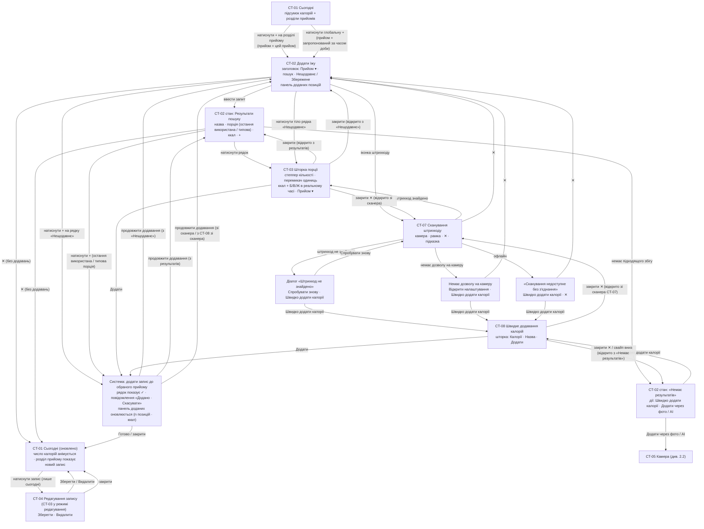
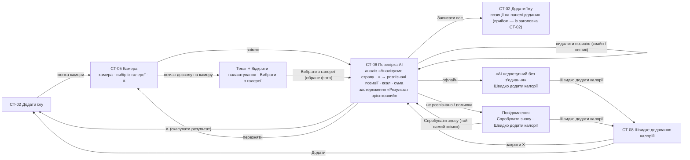

# Базовий потік обліку калорій — специфікація (чернетка для перегляду)

Статус: **чернетка; рішення D1–D7 і прийняті рішення власника продукту з §6 (Q3, Q7–Q28) затверджені, відкриті питання (Q5, Q6) очікують рішення.** Жодної візуальної роботи або роботи у Figma ще не виконано.
Основа: `docs/uk/research/` (BitePal, Lifesum, MyFitnessPal на Mobbin).

## 1. Принципи дизайну (з дослідження)

1. **Пошук на першому місці, з вкладкою «Нещодавнє» як вмістом за замовчуванням.** Так роблять усі три застосунки; це найшвидший шлях для повторюваних продуктів.
2. **Швидке додавання одним натисканням з будь-якого рядка списку**, з вбудованим ✓ і повідомленням (✓ — MFP, Lifesum; повідомлення — лише MFP).
3. **Редагування порції в шторці знизу з одним елементом керування і перемикачем одиниць** (BitePal), а не повноекранна форма (MFP).
4. **Прийом береться з контексту і ніколи не запитується двічі** (контекст MFP + меню; час у BitePal).
5. **Залишатися на екрані додавання, доки користувач не закінчить**, з бігучим лічильником доданого (підсумок на панелі BitePal + залишення на пошуку MFP).
6. **Без проміжних екранів після логування.** Користувач одразу повертається на оновлений головний екран (виключено звіт і серії BitePal).

## 2. Узгоджений потік

### 2.1 Основний шлях

### 2.2 Шлях фото / AI (входить у MVP, рішення Q8)

### 2.3 Покроково

| №   | Екран            | Дія користувача                                                 | Реакція системи                                                                                                  | Потрібна інформація                                |
| --- | ---------------- | --------------------------------------------------------------- | ---------------------------------------------------------------------------------------------------------------- | -------------------------------------------------- |
| 1   | CT-01 Сьогодні   | Бачить залишок ккал; натискає **+** на «Обід» (або глобальну +) | Відкриває CT-02 з Прийом = Обід (або типовим за часом)                                                           | Денна ціль, спожито, залишок, прийоми з підсумками |
| 2   | CT-02 Додати їжу | Бачить «Нещодавнє»; натискає **+** на «Грецький йогурт»              | Додає останню використану порцію (а якщо її немає — типову) до Обіду; рядок ✓; повідомлення «Додано до Обіду · Скасувати»; панель «1 позиція · 120 ккал» | Назва продукту, ккал, порція (остання використана / типова) |
| 3   | CT-02            | Вводить «банан»                                                 | Результати оновлюються під час введення (з затримкою)                                                            | Запит                                              |
| 4   | CT-02 результати | Натискає рядок «Банан»                                          | Відкриває шторку CT-03 над результатами                                                                          | —                                                  |
| 5   | CT-03 Порція     | Змінює 1 середній → 150 г перемикачем одиниць і степпером       | ккал і Б/В/Ж перераховуються в реальному часі                                                                    | Кількість, одиниця                                 |
| 6   | CT-03            | Натискає **Додати · 134 ккал**                                  | Шторка закривається; ✓ + повідомлення; панель «2 позиції · 254 ккал»                                             | —                                                  |
| 7   | CT-02            | Натискає **Готово**                                             | Повертається на CT-01                                                                                            | —                                                  |
| 8   | CT-01            | —                                                               | Число калорій анімується до нового значення; Обід показує 2 позиції, 254 ккал                                    | —                                                  |

**Стан завершення:** користувач на CT-01 «Сьогодні». Спожите і залишок оновлені, а розділ прийому показує нові записи, кожен з яких можна редагувати.

## 3. Ключові UX-рішення

### D1. Прийом їжі — до чи після продукту?

**Рішення: прийом береться з контексту, з розумним типовим значенням. Це ніколи не примусовий крок.**

- **+** на прийомі → цей прийом (картка + у Lifesum, «Log» на картці MFP).
- Глобальна + → прийом, запропонований за часом доби (BitePal позначає час; меню MFP показує ціну незнання).
- Показується як **випадаючий список «Обід ▾» у заголовку CT-02** (MFP) і на CT-03, тож його можна змінити без додаткового екрана.
- Меню з 4 прийомами: Сніданок, Обід, Вечеря, Перекус. Зміна в заголовку CT-02 діє на наступні додавання, уже додані позиції не змінюються; зміна на CT-03 стосується лише цієї позиції (рішення Q10).
- Відхилено: обов'язковий радіальний вибір Lifesum (+1 крок щоразу) і меню MFP на кожну + коли прийом не вибрано (+1 крок на кожну позицію).

### D2. Вибір продукту і кількості: окремі екрани чи один?

**Рішення: один інтерфейс. Кількість — шторка знизу над результатами пошуку (CT-03).**

- Шторка BitePal зберігає результати видимими, тож закриття повертає точно на ту саму позицію прокрутки. Lifesum і MFP відкривають повні екрани.
- **Один степпер кількості плюс перемикач одиниць** (порції ↔ г/мл, плюс специфічні для продукту одиниці, якщо вони є) замість двох полів MFP.
- Основна кнопка несе результат: **«Додати · 134 ккал»** (патерн BitePal «Log 390 kcal»).

### D3. Кілька продуктів за одну сесію?

**Рішення: так. Кожна позиція зберігається одразу; постійна панель доданих показує кількість і ккал.**

- Миттєве збереження (MFP, Lifesum) означає, що нічого не втрачається, якщо користувач вийде посеред сесії, і не потребує окремого кроку «Log».
- Бігучий підсумок (з панелі BitePal) дає видимість пакетного режиму без його додаткового кроку підтвердження.
- Скасування в повідомленні і видалення з панелі покривають помилки.

### D4. Повертатися на головний екран після кожної позиції?

**Рішення: ні.** Залишатися на CT-02 після кожного додавання (усі три застосунки дозволяють продовжувати). Повертатися на головний екран лише при **Готово** або закритті. Користувач з однією позицією робить одне зайве натискання (Готово), і це прийнятно. Два розглянуті альтернативи:

- Автоматичне повернення після однієї позиції: погіршує багатопродуктові прийоми.
- Підказка «Готово» після першого додавання: винесено як відкрите питання Q6.

### D5. Мінімізація взаємодій

- «Нещодавнє» — вміст за замовчуванням на CT-02 (усі три).
- Швидке + на кожному рядку (усі три) додає останню використану порцію, а якщо її немає — типову. **Остання використана порція** — рішення власника (Q17); жоден з застосунків явно її не показує.
- Прийом задано заздалегідь (D1).
- Без проміжних екранів після логування (виключено звіт і серії BitePal).
- Автофокус пошуку **не** за замовчуванням, щоб «Нещодавнє» залишалося видимим; дотик до поля пошуку відкриває клавіатуру. Див. Q5.

### D6. Суттєва та другорядна інформація

| Суттєве (завжди видно)                                                                | Другорядне (на вимогу / пізніше)                                       |
| ------------------------------------------------------------------------------------- | ---------------------------------------------------------------------- |
| Головний екран: спожито, ціль, **залишок**, прогрес; список прийомів з ккал за прийом | Спалені / вправи, серії, вода, голодування                             |
| Результати: назва, порція (остання використана / типова), ккал, позначка перевірки                            | Деталі бренду, оцінка продукту, «Best Match» (розглянути)              |
| Порція: кількість, одиниця, ккал в реальному часі, Б/В/Ж у грамах                     | Повні харчові факти, % від денної норми, кілька днів, звіт про продукт |

### D7. Найшвидший шлях для користувача, який повертається

**Сьогодні → + на прийомі → + на рядку «Нещодавнє» → Готово = 3 натискання** без введення тексту. Це збігається з найшвидшим спостереженим шляхом у MFP і Lifesum.

## 4. Перелік екранів

| ID        | Екран                          | Призначення                                                            | Точка входу                 | Основні компоненти                                                                                                                                                                                                                                                | Основна дія                     | Другорядні дії                                                                        | Стани                                                                                                                                                                                               | Переходи                                         |
| --------- | ------------------------------ | ---------------------------------------------------------------------- | --------------------------- | ----------------------------------------------------------------------------------------------------------------------------------------------------------------------------------------------------------------------------------------------------------------- | ------------------------------- | ------------------------------------------------------------------------------------- | --------------------------------------------------------------------------------------------------------------------------------------------------------------------------------------------------- | ------------------------------------------------ |
| **CT-01** | Сьогодні (денний огляд)        | Показати денний прогрес калорій і записані прийоми; почати логування   | Запуск застосунку  | Заголовок дати (‹ Сьогодні ›); підсумок калорій (спожито / ціль / залишок, кільце або смужка); смужки Б/В/Ж; розділи прийомів (Сніданок, Обід, Вечеря, Перекус), кожен з сумою ккал, рядками позицій, **+**; глобальна **+** (плаваюча кнопка)                                      | **+ (додати їжу)**              | Змінити дату стрілками ‹ › («Сьогодні» повертає на поточний день); на інших днях лише перегляд: **+** приховані, позиції не натискаються (CT-04 не відкривається), їжа записується тільки на сьогодні; натиснути позицію → редагувати; згорнути / розгорнути прийом (за замовчуванням розгорнуті, з рядками позицій)                       | Порожній день (нульовий стан + підказка в кожному прийомі); інший день без записів (підсумок 0 ккал, текст «Немає записів за цей день»); частковий; понад ціль (від'ємний залишок, окремий стиль); завантаження                                                                  | CT-02, CT-04                                     |
| **CT-02** | Додати їжу (пошук + Нещодавнє)    | Знайти продукти і додати їх до прийому                                 | CT-01 + (контекст прийому)  | Заголовок: ✕, **Прийом ▾**; поле пошуку (+ іконки камери / штрихкоду); сегментований перемикач **Нещодавнє / Збережене**; рядки списку (назва, порція — остання використана, а для нового продукту типова, ккал за цією порцією, **+**); **панель доданих** (n позицій · ккал · **Готово**)                                   | **+ швидке додавання** на рядку | Натиснути рядок → CT-03; змінити прийом; перемкнути вкладку; натиснути підсумок панелі → шторка зі списком позицій сесії («назва · порція · ккал», загальна сума зверху; видалення свайпом вліво або іконкою кошика без підтвердження, сума оновлюється; закриття ✕ або свайпом вниз; після видалення останньої позиції шторка закривається, панель доданих приховується); Скасувати (повідомлення) | «Нещодавнє» заповнено; **перше використання (немає недавніх)**: текст-підказка; «Збережене»: збережені продукти (ті самі рядки, що в «Нещодавнє»), порожнє — текст-підказка; введення / завантаження; результати; **немає результатів** (дії: «Швидко додати калорії» → CT-08; «Додати через фото / AI» → CT-05); рядок додано (✓; повторне **+** додає ще одну порцію); офлайн («Нещодавнє» / «Збережене» і швидке додавання калорій працюють; пошук недоступний, у полі пошуку повідомлення «Пошук недоступний без з'єднання»; сканування штрихкоду і фото/AI недоступні — повідомлення на CT-07 / CT-06) | CT-03, CT-01 (Готово / ✕), CT-05, CT-07, CT-08 |
| **CT-03** | Шторка порції (шторка знизу)   | Встановити кількість і одиницю, побачити харчову цінність, підтвердити | Натискання рядка на CT-02; знайдений штрихкод на CT-07 | Назва продукту + позначка перевірки; **степпер кількості** (− значення +) з цифровою клавіатурою при натисканні; **перемикач одиниць** (порція / г / мл, одиниці продукту); **ккал** + Б/В/Ж у грамах в реальному часі; **Прийом ▾**; основна **Додати · N ккал** | **Додати**                      | Змінити прийом; додати у «Збережене»; розкривний блок «Більше харчової цінності» | Типова порція; змінено; некоректно (0 / порожньо → кнопка вимкнена)                                                                                                                                 | CT-02 (після Додати; закрити — якщо відкрито з CT-02); CT-07 (закрити — якщо відкрито зі сканера) |
| **CT-04** | Редагування запису             | Змінити або видалити записану позицію                                  | Натискання позиції на CT-01 | Те саме, що CT-03, у режимі редагування                                                                                                                                                                                                                           | **Зберегти**                    | **Видалити** (з повідомленням для скасування)                                         | Редагування; видалено                                                                                                                                                                               | CT-01                                            |
| **CT-05**   | Камера       | Зняти фото страви для AI                                             | Іконка камери на CT-02    | Видошукач, затвор, галерея, закрити                                                                                                                                                                                                                             | Зняти                         | Галерея                                                                             | Немає дозволу на камеру (текст · «Відкрити налаштування» · «Вибрати з галереї» → CT-06); зйомка                                                                                                                                                                         | CT-06, CT-02                                   |
| **CT-06**   | Перевірка AI | Підтвердити виявлені позиції перед логуванням                        | CT-05                         | Список розпізнаних позицій (назва, грами, ккал; видалення свайпом або кошиком), сума ккал, застереження «Результат орієнтовний», ✕, Перезняти, **Записати все**                                                                                                                                                           | Записати все                  | Видалити позицію; перезняти; ✕ (скасувати результат)                                               | Аналіз («Аналізуємо страву…», ✕ скасування); результати; їжу не розпізнано / помилка (повідомлення з діями: «Спробувати знову» повторює аналіз того самого знімка; «Швидко додати калорії» → CT-08, ✕ → CT-06, Додати → CT-02); офлайн (повідомлення «AI недоступний без з'єднання» і дія «Швидко додати калорії» → CT-08; «Спробувати знову» немає)                                                                                                                                          | CT-02 (Записати все / ✕; прийом — із заголовка CT-02), CT-05 (Перезняти), CT-08 (з повідомлення про помилку)                                   |
| **CT-07**   | Сканування штрихкоду | Знайти продукт за штрихкодом | Іконка штрихкоду в полі пошуку CT-02 | Повноекранна камера з рамкою, ✕ зверху, підказка, індикатор «Пошук…» після розпізнавання | Сканувати | ✕; «Швидко додати калорії» (з діалогу, станів без камери і офлайн) | Сканування; «Пошук…»; знайдено; не знайдено (діалог «Штрихкод не знайдено» з діями «Спробувати знову» і «Швидко додати калорії»); немає дозволу на камеру (те саме, що на CT-05, але замість «Вибрати з галереї» — «Швидко додати калорії»); офлайн («Сканування недоступне без з'єднання» · «Швидко додати калорії» · ✕) | CT-03 (знайдено), CT-08 (з діалогу, станів без камери і офлайн), CT-02 (✕) |
| **CT-08**   | Швидке додавання калорій (шторка знизу) | Додати позицію, ввівши лише калорії | Стан «Немає результатів» на CT-02; діалог «Штрихкод не знайдено», стани без дозволу камери і офлайн на CT-07; повідомлення про помилку на CT-06 | Заголовок «Швидке додавання калорій»; ✕; поле **Калорії** (обов'язкове, цифрова клавіатура); поле **Назва** (необов'язкове); **Додати** | Додати | Закрити (✕ або свайп вниз) | Калорії порожні (**Додати** вимкнена); готово до додавання; назва порожня → позиція підписується «Швидке додавання» (на панелі доданих CT-02 і в розділі прийому CT-01) | CT-02 (після Додати: позиція потрапляє на панель доданих, прийом — із заголовка CT-02; закрити — якщо відкрито з «Немає результатів»); CT-07 (закрити — якщо відкрито зі сканера); CT-06 (закрити — якщо відкрито з помилки AI) |

**Кількість:** 3 основні екрани (CT-01, CT-02, CT-03), плюс 1 режим редагування, що використовує CT-03 (CT-04). Логування фото AI входить до MVP (рішення Q8): додаються 2 екрани (CT-05, CT-06). Сканування штрихкоду (Q8, Q19) додає екран CT-07, швидке додавання калорій (Q3, Q18) — шторку CT-08.

## 5. Деталі взаємодії

- **Повідомлення:** «Додано до Обіду · Скасувати». Триває близько 4 с і з'являється над панеллю доданих. Скасування видаляє запис і ✓.
- **Панель доданих:** з'являється після першого додавання, показує «2 позиції · 254 ккал» і містить кнопку **Готово**. Натискання на підсумок відкриває шторку зі списком позицій сесії (рядки «назва · порція · ккал», загальна сума зверху); позицію можна видалити свайпом вліво або іконкою кошика без підтвердження, сума оновлюється; шторка закривається ✕ або свайпом вниз, а після видалення останньої позиції закривається сама, і панель доданих приховується (рішення Q7, Q20).
- **Перерахунок в реальному часі:** ккал = ккал на грам × грами (або на порцію × порції). Значення округлюються до цілих ккал і 1 знака після коми для грамів.
- **Оновлення головного екрана:** при поверненні число спожитого анімується, а відповідний розділ прийому коротко підсвічується. Без спостережуваного прикладу це лише рекомендація щодо руху **[I]**.
- **Швидке додавання калорій (запасний варіант, коли нічого не знайдено):** є і в Lifesum, і в MFP. Входить у MVP (рішення Q3); шторка CT-08 (рішення Q18). У стані «Немає результатів» пропонується разом із додаванням через фото / AI; також доступне з діалогу «Штрихкод не знайдено», зі станів CT-07 без дозволу камери і офлайн та з повідомлення про помилку AI на CT-06.
- **Розташування (рішення Q15):** CT-01 — заголовок дати фіксований, контент прокручується, глобальна + — плаваюча кнопка, нижньої навігаційної панелі немає. CT-02 — заголовок і поле пошуку фіксовані, список прокручується, панель доданих прикріплена внизу, повідомлення з'являється над нею.

## 6. Відкриті питання

| ID | Питання | Варіанти з документа | Пов'язано |
| --- | --- | --- | --- |
| Q5 | Автофокус пошуку на CT-02 | за замовчуванням вимкнено (D5), дотик відкриває клавіатуру | D5 |
| Q6 | Підказка «Готово» після першого додавання | див. D4 | D4 |

Примітка: формулювання Q1, Q2, Q4 у документі відсутнє; якщо такі питання існували, власнику слід їх відновити.

### Прийняті рішення власника продукту

| ID | Рішення |
| --- | --- |
| Q3 [RV-003] | «Швидке додавання калорій» входить у MVP (шторка CT-08 — Q18) |
| Q7 [RV-002] | Натискання на підсумок панелі доданих показує список позицій сесії з видаленням |
| Q8 [RV-004] | Фото/AI (CT-05, CT-06) і штрихкод входять у MVP (екран штрихкоду CT-07 — Q19) |
| Q9 [RV-006] | Повторне «+» на вже доданому рядку додає ще одну порцію |
| Q10 [RV-007] | «Прийом ▾» — меню з 4 прийомами; зміна в заголовку CT-02 діє на наступні додавання; зміна на CT-03 — лише на цю позицію |
| Q11 [RV-008] | Розділи прийомів на CT-01 за замовчуванням розгорнуті, їх можна згорнути |
| Q12 [RV-009] | Їжа записується лише на сьогодні; на інших днях «+» приховані, дата лише для перегляду |
| Q13 [RV-010] | Вкладка «Збережене» — збережені продукти; порожній стан — текст-підказка |
| Q14 [RV-011] | Офлайн: «Нещодавнє» / «Збережене» і швидке додавання калорій працюють, пошук недоступний з повідомленням |
| Q15 [RV-012] | CT-01: плаваюча «+», без нижньої навігації; CT-02: панель доданих прикріплена внизу |
| Q16 [RV-014] | D1–D7 затверджені |
| Q17 [RV-019] | Швидке «+» додає останню використану порцію, а якщо її немає — типову |
| Q18 [RV-003] | Швидке додавання калорій — шторка CT-08 з полями «Калорії» (обов'язкове) і «Назва»; у стані «Немає результатів» пропонуються швидке додавання і AI-фото |
| Q19 [RV-004] | Штрихкод — екран CT-07: знайдено → CT-03; не знайдено → діалог «Спробувати знову» / «Швидко додати калорії»; ✕ → CT-02 |
| Q20 [RV-021] | Підсумок панелі доданих відкриває шторку зі списком позицій; видалення свайпом або кошиком; після видалення останньої позиції панель приховується |
| Q21 [RV-022] | Інші дні лише для перегляду (без CT-04); день без записів — текст «Немає записів за цей день»; дата змінюється стрілками ‹ › |
| Q22 [RV-024] | Рядок списку показує порцію, яку додасть «+» (остання використана, інакше типова) |
| Q23 [RV-023] | Вкладка «Recent» називається «Нещодавнє» |
| Q24 [RV-025] | Фото/AI: CT-05 → CT-06 → «Записати все» додає позиції на панель CT-02 і повертає на CT-02; ✕ на CT-06 скасовує результат; на CT-06 позицію можна лише видалити |
| Q25 [RV-026] | Стани CT-05/CT-06: немає дозволу на камеру; аналіз; не розпізнано / помилка / офлайн; застереження «Результат орієнтовний» |
| Q26 [RV-027] | Після «Додати» у CT-03, відкритій зі сканера, — CT-02; ✕ на CT-03 і CT-08, відкритих зі сканера, повертає на CT-07 |
| Q27 [RV-028] | «Спробувати знову» повторює аналіз того самого знімка; «Вибрати з галереї» → CT-06; «Швидко додати калорії» з помилки AI → CT-08 (✕ → CT-06, Додати → CT-02) |
| Q28 [RV-030] | CT-07 без дозволу камери — як CT-05 (замість галереї «Швидко додати калорії»); офлайн — «Сканування недоступне без з'єднання»; позиція CT-08 без назви підписується «Швидке додавання» |
| Q29 [RV-031] | Офлайн на CT-06: повідомлення «AI недоступний без з'єднання» і дія «Швидко додати калорії» (без «Спробувати знову») |
