# Онбординг: стартова денна норма калорій — специфікація потоку

Статус: **чернетка для перегляду власником продукту.** Рішення D1–D13 — пропозиції автора на основі дослідження (ще не затверджені); D14–D18 затверджені власником продукту 2026-11-17; відкриті питання Q1–Q11 мають значення за замовчуванням, з якими малюються вайрфрейми.
Обсяг: **входить** — перший запуск від вітання до першого запису їжі: ON-01…ON-11 і перехід у CT-02 / CT-01 з `core-calorie-tracking-flow.md`. **Не входить** — створення акаунта і вхід, підписка, налаштування профілю після онбордингу, нагадування, підключення Apple Health / Health Connect, адаптивне уточнення норми (див. `adaptive-personalization.md`).
Платформа: мобільний застосунок, low-fidelity вайрфрейми, пристрій 390 × 844 (як у наявних вайрфреймах). Мова інтерфейсу: українська.
Джерела: `../research/onboarding-research.md` (R1–R6, M1–M2), `calculation-model.md` (формули, S1–S13), `onboarding-questionnaire.md` (Q-01…Q-13), `core-calorie-tracking-flow.md` (CT-01, CT-02 — без змін).

Позначення: **[I]** — висновок автора, не прямий факт із джерела. `{…}` — значення з розрахунку (приклад «Олена», §6).

---

## 1. Сценарії

### 1.1 Основний сценарій (новий користувач, мета «Схуднути», приклад «Олена»)

| № | Екран | Дія користувача | Результат |
|---|---|---|---|
| 1 | ON-01 Вітання | «Почати» | ON-02 |
| 2 | ON-02 Мета | натискає картку «Схуднути» | картка обрана → автоматичний перехід на ON-03 (D12) |
| 3 | ON-03 Про вас | «Жіноча», рік 1992 (колесо), зріст 165 → «Далі» | ON-04 |
| 4 | ON-04 Вага | 78 і 68 → «Далі» | ON-05 |
| 5 | ON-05 Здоров'я | «Нічого з цього» | ON-06 |
| 6 | ON-06 Ваш звичайний день | «Переважно сиджу», «Як більшість» → «Далі» | ON-07 |
| 7 | ON-07 Тренування | «3–4 рази» → з'являються «Які переважно?» і «Скільки триває?» → «Помірні», «45 хв» (уже обрано) → «Далі» | ON-08 |
| 8 | ON-08 Темп | «Комфортно · 1 750 ккал» уже обрано → «Далі» | ON-09 |
| 9 | ON-09 Ваш план | бачить «1 750 ккал», «≈2 190 ккал витрата»; (необов'язково) розгортає «Як ми це порахували» → «Записати першу їжу» | CT-02 Додати їжу (прийом — за часом доби, як при глобальній «+» у CT-01) |
| 10 | CT-02 → … → «Готово» | основний потік обліку (без змін) | CT-01 Сьогодні: «Ціль 1 750 ккал», коридор «1 650–1 850» і перший запис |

Кроків із запитаннями: 7 (для «Підтримувати вагу» — 6, ON-08 пропускається). Від «Почати» до норми — 8 екранів без жодного проміжного (мотиваційного, рекламного, реєстраційного) екрана; ще один екран — і користувач уже записує першу їжу.

### 1.2 Умовні гілки

| Умова | Де визначається | Куди веде |
|---|---|---|
| Мета «Підтримувати вагу» | ON-02 | ON-04 без поля «Бажана вага»; ON-07 → ON-09 (ON-08 пропущено); прогрес — 6 кроків |
| Мета «Набрати вагу» | ON-02 | ON-08 у варіанті набору (2 картки) |
| Вік < 18 | ON-03 «Далі» | ON-11 (варіант «вік») |
| Бажана вага не в напрямку мети | ON-04 | ON-04.S3 (помилка поля) |
| Бажана вага з ІМТ < 18,5 | ON-04 | ON-04.S4 |
| Поточний ІМТ < 18,5 і «Схуднути» | ON-04 «Далі» | ON-04.S5 |
| «Вагітність» / «Годую груддю» | ON-05 «Далі» | ON-11 (варіант «вагітність») |
| «Розлад харчової поведінки» | ON-05 «Далі» | ON-11 (варіант «РХП»); має пріоритет над іншими позначками |
| Лише «Захворювання…» | ON-05 «Далі» | ON-06 (розрахунок дозволено); на ON-08 «Активно» неактивне; на ON-09 — порада |
| Тренувань «Ні» | ON-07 | блок типу й тривалості прихований |
| Варіант темпу перевищує обмеження | ON-08 | картка неактивна (ON-08.S2) |

### 1.3 Повернення та редагування

- **Назад:** «‹» у заголовку ON-02…ON-11 веде на попередній екран **цього проходу** (з урахуванням пропущених). Відповіді не втрачаються. Системний жест «назад» працює так само. ON-01 — без «‹».
- **Редагування після результату:** ON-09 «Змінити відповіді» → ON-10 (список усіх відповідей) → натискання рядка відкриває відповідний екран у режимі редагування (стан `.SE`: замість прогресу — заголовок «Змінити відповідь», кнопка «Зберегти») → «Зберегти» повертає на ON-10 з оновленим значенням → «Готово» на ON-10 → ON-09 з перерахованою нормою.
- Якщо під час редагування зміна вимагає нового запитання (наприклад, мета «Підтримувати» → «Схуднути» потребує темпу), після «Зберегти» на ON-02 відкривається ON-08 у режимі редагування, потім ON-10.
- Якщо зміна вмикає правило безпеки (вік < 18, позначки ON-05), після «Зберегти» відкривається ON-11.

```mermaid
flowchart LR
  ON01[ON-01 Вітання] -->|Почати| ON02[ON-02 Мета]
  ON02 -->|картка| ON03[ON-03 Про вас]
  ON03 -->|Далі, вік ≥ 18| ON04[ON-04 Вага]
  ON03 -->|Далі, вік < 18| ON11[ON-11 План без норми]
  ON04 -->|Далі| ON05[ON-05 Здоров'я]
  ON05 -->|Нічого з цього / лише «Захворювання»| ON06[ON-06 Звичайний день]
  ON05 -->|вагітність / годування / РХП| ON11
  ON06 -->|Далі| ON07[ON-07 Тренування]
  ON07 -->|Далі: схуднути / набрати| ON08[ON-08 Темп]
  ON07 -->|Далі: підтримувати| ON09[ON-09 Ваш план]
  ON08 -->|Далі| ON09
  ON09 -->|Записати першу їжу| CT02[CT-02 Додати їжу]
  ON09 -->|Перейти до щоденника| CT01[CT-01 Сьогодні]
  ON09 -->|Змінити відповіді| ON10[ON-10 Ваші відповіді]
  ON10 -->|рядок| EDIT[екран ON-02…ON-08 у стані .SE]
  EDIT -->|Зберегти| ON10
  EDIT -->|Зберегти: мета стала «Схуднути»/«Набрати»| ON08E[ON-08 у стані .SE]
  ON08E -->|Зберегти| ON10
  EDIT -->|Зберегти: вік < 18 / позначки ON-05| ON11
  ON04 -->|Далі: «Схуднути» і ІМТ < 18,5| ON04S5[ON-04.S5]
  ON04S5 -->|Обрати «Підтримувати вагу»| ON05
  ON10 -->|Готово| ON09
  ON11 -->|Продовжити без норми| CT01
  ON11 -->|Змінити відповідь| BACK[екран, що спричинив ON-11]
  CT02 -->|Готово| CT01
```

Діаграма похідна від таблиць Actions нижче; при розбіжності правильні таблиці.

---

## 2. Екрани

Спільні правила для ON-02…ON-08 (компонент **WF/Onboarding/Header**, §3): зверху «‹» і смуга прогресу з сегментами; під заголовком запитання — сірий рядок-пояснення «навіщо питаємо» (D4); основна кнопка закріплена внизу над безпечною зоною, неактивна, доки відповіді не валідні. Вміст між заголовком і кнопкою прокручується, якщо не вміщується.

### ON-01 Вітання — type: screen
Goal: пояснити цінність і час, почати. · Entry: перший запуск застосунку (немає збережених відповідей онбордингу). · Main journey: yes

Layout (top → bottom)
| # | Region | Elements and visible content | Behaviour |
|---|---|---|---|
| 1 | Status bar | системний | fixed |
| 2 | Hero | місце під ілюстрацію «[ілюстрація]» (сіра область) | fixed |
| 3 | Value | заголовок «Порахуємо вашу денну норму калорій» · текст «7 коротких запитань — близько хвилини. Потім одразу запишете першу їжу.» | fixed |
| 4 | Bottom action | основна кнопка «Почати» | sticky внизу |

Actions
| Element | Gesture | Condition | Result |
|---|---|---|---|
| «Почати» | tap | — | ON-02 |

States
| ID | State | Trigger | Shown as | What differs |
|---|---|---|---|---|
| ON-01.S1 | За замовчуванням | запуск | own frame | — |

### ON-02 Мета — type: screen
Goal: дізнатися мету. · Entry: ON-01 «Почати»; ON-03 «‹»; ON-10 рядок «Мета» (стан .SE). · Main journey: yes

Layout
| # | Region | Elements and visible content | Behaviour |
|---|---|---|---|
| 1 | Status bar | системний | fixed |
| 2 | Header | «‹» · прогрес 7 сегментів, заповнено 1 | fixed |
| 3 | Question | заголовок «Чого ви хочете досягти?» · пояснення «Від цього залежить, чи додамо до вашої норми дефіцит або запас калорій.» | fixed |
| 4 | Options | 3 картки-варіанти на всю ширину: «Схуднути» · «Підтримувати вагу» · «Набрати вагу» | fixed |
| 5 | Bottom action | «Зберегти» — **лише в стані ON-02.SE** | sticky |

Кнопки «Далі» немає (D12).

Actions
| Element | Gesture | Condition | Result |
|---|---|---|---|
| картка | tap | звичайний прохід | картка в стані «обрано» → ON-03 |
| картка | tap | стан .SE | картка «обрано» (кнопка «Зберегти» стає активною) |
| «Зберегти» | tap | .SE, мета змінилася на «Схуднути»/«Набрати» з «Підтримувати» | ON-08 у стані .SE |
| «Зберегти» | tap | .SE, інакше | ON-10 |
| «‹» | tap | звичайний прохід | ON-01 |
| «‹» | tap | .SE | ON-10 без змін |

States
| ID | State | Trigger | Shown as | What differs |
|---|---|---|---|---|
| ON-02.S1 | Нічого не обрано | вхід з ON-01 | own frame | — |
| ON-02.S2 | Обрано «Схуднути» | user: tap картки | variant (картка «обрано») | рамка/позначка на картці |
| ON-02.SE | Редагування | ON-10 рядок «Мета» | variant Header + кнопка | прогрес → заголовок «Змінити відповідь»; внизу з'являється «Зберегти»; поточна мета обрана |

### ON-03 Про вас — type: screen
Goal: дані для енергії спокою. · Entry: ON-02 вибір картки; ON-04 «‹»; ON-10 рядки «Стать для розрахунку», «Рік народження», «Зріст». · Main journey: yes

Layout
| # | Region | Elements and visible content | Behaviour |
|---|---|---|---|
| 1 | Status bar | системний | fixed |
| 2 | Header | «‹» · прогрес, заповнено 2 | fixed |
| 3 | Question | «Трохи про вас» · «Потрібно, щоб оцінити, скільки енергії ваше тіло витрачає в спокої.» | fixed |
| 4 | Sex | підпис «Стать для розрахунку» · сегментований перемикач «Жіноча / Чоловіча / Не вказувати» · підказка «Формули енергообміну різні для жіночого й чоловічого організму.» | scrolls |
| 5 | Birth year | поле «Рік народження», значення або плейсхолдер «Оберіть рік» · «▾» | scrolls |
| 6 | Height | поле «Зріст, см» (цифрова клавіатура) | scrolls |
| 7 | Bottom action | «Далі» | sticky |

Actions
| Element | Gesture | Condition | Result |
|---|---|---|---|
| сегмент статі | tap | — | обраний сегмент (variant) |
| поле «Рік народження» | tap | — | ON-03.S3 (колесо вибору року знизу) |
| «Готово» у колесі | tap | — | колесо закривається, рік у полі → ON-03.S2 |
| затемнення поза шторкою / свайп вниз | tap / swipe | ON-03.S3 | шторка закривається без зміни значення → попередній стан ON-03 |
| поле «Зріст, см» | tap | — | цифрова клавіатура (системна) |
| «Далі» | tap | усі 3 заповнені, зріст 100–250, вік ≥ 18 | ON-04 |
| «Далі» | tap | вік < 18 | ON-11 (варіант «вік») |
| «Далі» | tap | зріст поза 100–250 | ON-03.S4 |
| «Зберегти» | tap | .SE | ON-10 (або ON-11, якщо вік < 18) |
| «‹» | tap | — | ON-02 (у .SE — ON-10 без змін) |

States
| ID | State | Trigger | Shown as | What differs |
|---|---|---|---|---|
| ON-03.S1 | Порожньо | вхід | own frame | «Далі» неактивна |
| ON-03.S2 | Заповнено | user: усі поля | own frame | «Жіноча», «1992», «165»; «Далі» активна |
| ON-03.S3 | Колесо року | user: tap поля року | own frame (шторка поверх затемненого ON-03) | шторка: заголовок «Рік народження», колесо (… 1990 · 1991 · **1992** · 1993 …), «Готово» |
| ON-03.S4 | Некоректний зріст | system: значення поза 100–250 | variant поля | поле з помилкою «Вкажіть зріст від 100 до 250 см»; «Далі» неактивна |
| ON-03.SE | Редагування | ON-10 | variant | як ON-02.SE |

### ON-04 Вага — type: screen
Goal: поточна і (необов'язково) бажана вага. · Entry: ON-03 «Далі»; ON-05 «‹»; ON-10 рядок «Вага». · Main journey: yes

Layout
| # | Region | Elements and visible content | Behaviour |
|---|---|---|---|
| 1 | Status bar | системний | fixed |
| 2 | Header | «‹» · прогрес, заповнено 3 | fixed |
| 3 | Question | «Ваша вага» | fixed |
| 4 | Current | поле «Зараз, кг» · підказка «Можна приблизно — уточните, коли зважитеся.» | scrolls |
| 5 | Goal weight | поле «Бажана вага, кг» з міткою «необов'язково» · підказка «Не змінює денну норму. Покажемо, скільки лишилося до мети.» — **лише для «Схуднути» / «Набрати»** | scrolls |
| 6 | Bottom action | «Далі» | sticky |

Actions
| Element | Gesture | Condition | Result |
|---|---|---|---|
| поля | tap | — | цифрова клавіатура з комою |
| «Далі» | tap | поточна 30–300; бажана порожня або коректна; не S5 | ON-05 |
| «Далі» | tap | «Схуднути» і поточний ІМТ < 18,5 | ON-04.S5 |
| «Обрати «Підтримувати вагу»» | tap | ON-04.S5 | мета = «Підтримувати»; поле бажаної ваги ховається; прогрес 6 кроків → ON-05 |
| «Встановити {мін} кг» | tap | ON-04.S4 | у поле бажаної ваги підставляється мінімальна здорова вага, помилка зникає |
| «‹» | tap | — | ON-03 (.SE — ON-10) |
| «Зберегти» | tap | .SE, валідно | ON-10 |

States
| ID | State | Trigger | Shown as | What differs |
|---|---|---|---|---|
| ON-04.S1 | Порожньо | вхід | own frame | «Далі» неактивна |
| ON-04.S2 | Заповнено | user | own frame | «78», «68»; «Далі» активна |
| ON-04.S3 | Не той напрямок | system: «Схуднути» і бажана ≥ поточної (або «Набрати» і бажана ≤ поточної) | variant поля | помилка під полем: «Для схуднення бажана вага має бути меншою за поточну» / «Для набору — більшою за поточну»; «Далі» неактивна |
| ON-04.S4 | Нижче здорового діапазону | system: бажана вага з ІМТ < 18,5 | own frame | помилка: «Ця вага нижча за здоровий діапазон для вашого зросту. Найменша рекомендована — {51} кг.» + текстова кнопка «Встановити {51} кг»; «Далі» неактивна |
| ON-04.S5 | Уже низька вага | system: «Далі» при «Схуднути» і поточному ІМТ < 18,5 | own frame | над кнопкою блок: «Ваша вага вже в нижній межі норми, тому план схуднення ми не пропонуємо.» + кнопка «Обрати «Підтримувати вагу»»; «Далі» прихована |
| ON-04.V-maintain | Мета «Підтримувати» | ON-02 | variant | регіону 5 немає |
| ON-04.SE | Редагування | ON-10 | variant | як ON-02.SE |

### ON-05 Здоров'я — type: screen
Goal: вимкнути небезпечний розрахунок. · Entry: ON-04 «Далі»; ON-06 «‹»; ON-10 рядок «Здоров'я»; ON-11 «Змінити відповідь» (варіанти «вагітність», «РХП»). · Main journey: yes

Layout
| # | Region | Elements and visible content | Behaviour |
|---|---|---|---|
| 1 | Status bar | системний | fixed |
| 2 | Header | «‹» · прогрес, заповнено 4 | fixed |
| 3 | Question | «Чи стосується вас щось із цього?» · «Так ми не запропонуємо план, який може зашкодити.» | fixed |
| 4 | Checklist | рядки з прапорцями: «Вагітність»* · «Годую груддю»* · «Розлад харчової поведінки — зараз або в минулому» · «Захворювання, через яке лікар контролює моє харчування» з підписом «наприклад, діабет на інсуліні, хвороба нирок». *лише для «Жіноча» / «Не вказувати» | scrolls |
| 5 | Bottom action | основна кнопка «Нічого з цього» (нічого не позначено) або «Далі» (позначено ≥ 1) | sticky |

Actions
| Element | Gesture | Condition | Result |
|---|---|---|---|
| рядок | tap | — | прапорець перемикається; підпис кнопки змінюється (ON-05.S2) |
| «Нічого з цього» | tap | нічого не позначено | ON-06 |
| «Далі» | tap | позначено «РХП» | ON-11 (варіант «РХП») |
| «Далі» | tap | позначено «Вагітність» або «Годую груддю» (без «РХП») | ON-11 (варіант «вагітність») |
| «Далі» | tap | позначено лише «Захворювання…» | ON-06 (прапорець `medical_supervision`) |
| «‹» | tap | — | ON-04 (.SE — ON-10) |

States
| ID | State | Trigger | Shown as | What differs |
|---|---|---|---|---|
| ON-05.S1 | Нічого не позначено | вхід | own frame | кнопка «Нічого з цього» |
| ON-05.S2 | Позначено | user: tap рядка | own frame | прапорець ✓ на «Захворювання…»; кнопка «Далі» |
| ON-05.V-male | Стать «Чоловіча» | ON-03 | variant | рядків «Вагітність», «Годую груддю» немає |
| ON-05.SE | Редагування | ON-10 | variant | як ON-02.SE |

### ON-06 Ваш звичайний день — type: screen
Goal: робота й щоденний рух (дві складові активності). · Entry: ON-05; ON-07 «‹»; ON-10 рядок «Звичайний день». · Main journey: yes

Layout
| # | Region | Elements and visible content | Behaviour |
|---|---|---|---|
| 1 | Status bar | системний | fixed |
| 2 | Header | «‹» · прогрес, заповнено 5 | fixed |
| 3 | Question | «Як минає ваш звичайний день?» · «Подумайте про роботу, навчання чи домашні справи.» | scrolls |
| 4 | Work options | 4 рядки-варіанти з підписом: «Переважно сиджу» — «офіс, навчання, за кермом» · «Переважно стою» — «продавець, викладач, перукар» · «Багато ходжу» — «кур'єр, офіціант, медсестра» · «Важка фізична робота» — «будівництво, склад, сільське господарство» | scrolls |
| 5 | Movement | підзаголовок «А поза роботою?» · 3 рядки: «Рухаюся мало» — «до 5 тис. кроків» · «Як більшість» — «5–10 тис. кроків» · «Багато ходжу» — «понад 10 тис. кроків, пішки чи велосипедом» · підказка «Не знаєте кроків? Обирайте за відчуттям.» | scrolls |
| 6 | Bottom action | «Далі» | sticky |

Actions
| Element | Gesture | Condition | Result |
|---|---|---|---|
| рядок групи 4 / 5 | tap | — | один обраний у групі (variant) |
| «Далі» | tap | обрано в обох групах | ON-07 |
| «‹» | tap | — | ON-05 (.SE — ON-10) |
| «Зберегти» | tap | .SE | ON-10 |

States
| ID | State | Trigger | Shown as | What differs |
|---|---|---|---|---|
| ON-06.S1 | Нічого не обрано | вхід | own frame | «Далі» неактивна |
| ON-06.S2 | Обрано | user | own frame | «Переважно сиджу», «Як більшість»; «Далі» активна |
| ON-06.SE | Редагування | ON-10 | own frame | заголовок «Змінити відповідь», обрані поточні значення, «Зберегти» |

### ON-07 Тренування — type: screen
Goal: третя складова активності. · Entry: ON-06; ON-08 / ON-09 «‹»; ON-10 рядок «Тренування». · Main journey: yes

Layout
| # | Region | Elements and visible content | Behaviour |
|---|---|---|---|
| 1 | Status bar | системний | fixed |
| 2 | Header | «‹» · прогрес, заповнено 6 | fixed |
| 3 | Question | «Чи тренуєтесь ви?» · «Рахуємо лише навмисні тренування — прогулянки вже враховані.» | scrolls |
| 4 | Frequency | чіпи в рядок: «Ні» · «1–2 рази» · «3–4 рази» · «5+ разів» · підпис «на тиждень» | scrolls |
| 5 | Kind | **лише якщо частота ≠ «Ні»:** підзаголовок «Які переважно?» · 3 рядки: «Легкі» — «йога, розтяжка, пілатес» · «Помірні» — «силові, плавання, танці, велосипед» · «Інтенсивні» — «біг, HIIT, командні ігри, єдиноборства» | scrolls |
| 6 | Duration | **лише якщо частота ≠ «Ні»:** «Скільки зазвичай триває?» · чіпи «30 хв» · «45 хв» (обрано) · «1 год» · «1,5 год+» | scrolls |
| 7 | Bottom action | «Далі» | sticky |

Actions
| Element | Gesture | Condition | Result |
|---|---|---|---|
| чіп «Ні» | tap | — | ON-07.S2 |
| чіп частоти ≠ «Ні» | tap | — | ON-07.S3 (розкриваються регіони 5–6) |
| рядок типу / чіп тривалості | tap | — | обраний (variant) |
| «Далі» | tap | «Ні» або (частота + тип) і мета «Схуднути»/«Набрати» | ON-08 |
| «Далі» | tap | те саме, мета «Підтримувати» | ON-09 |
| «‹» | tap | — | ON-06 (.SE — ON-10) |
| «Зберегти» | tap | .SE | ON-10 |

States
| ID | State | Trigger | Shown as | What differs |
|---|---|---|---|---|
| ON-07.S1 | Нічого не обрано | вхід | own frame | регіони 5–6 приховані; «Далі» неактивна |
| ON-07.S2 | «Ні» | user | variant | чіп «Ні» обраний; «Далі» активна |
| ON-07.S3 | Частота обрана | user: чіп ≠ «Ні» | own frame | «3–4 рази» обрано; регіони 5–6 показані; «45 хв» обрано; тип не обрано; «Далі» неактивна |
| ON-07.S4 | Заповнено | user: тип | own frame | «Помірні» обрано; «Далі» активна |
| ON-07.SE | Редагування | ON-10 | variant | як ON-02.SE |

### ON-08 Темп — type: screen
Goal: вибрати темп, побачивши, як він змінює норму. · Entry: ON-07 «Далі» (мета «Схуднути»/«Набрати»); ON-09 «‹»; ON-10 рядок «Темп»; ON-02 «Зберегти» (.SE, див. Actions ON-02). · Main journey: yes (для «Схуднути»/«Набрати»)

Layout
| # | Region | Elements and visible content | Behaviour |
|---|---|---|---|
| 1 | Status bar | системний | fixed |
| 2 | Header | «‹» · прогрес, заповнено 7 | fixed |
| 3 | Question | «Як швидко хочете рухатися?» · «Комфортний темп легше втримати. Змінити можна будь-коли.» | fixed |
| 4 | Pace options | картки-варіанти (radio), у кожній: назва · «≈{темп} кг на тиждень» · «{норма} ккал на день». Схуднення: «Легко» · «Комфортно» з міткою «Рекомендовано» · «Активно». Набір: «Легко» з міткою «Рекомендовано» · «Активно» | scrolls |
| 5 | Bottom action | «Далі» | sticky |

Actions
| Element | Gesture | Condition | Result |
|---|---|---|---|
| активна картка | tap | — | обрана (variant) |
| неактивна картка | tap | — | нічого (підпис уже пояснює причину) |
| «Далі» | tap | обрано | ON-09 |
| «‹» | tap | — | ON-07 (.SE — ON-10) |
| «Зберегти» | tap | .SE | ON-10 |

States
| ID | State | Trigger | Shown as | What differs |
|---|---|---|---|---|
| ON-08.S1 | За замовчуванням | вхід | own frame | обрано рекомендований (або найшвидший доступний, не швидший за рекомендований); «Далі» активна |
| ON-08.S2 | Варіант недоступний | system: обмеження безпеки (`calculation-model.md` §4.3) | variant картки | картка неактивна; замість норми: «Недоступно для ваших даних — дефіцит був би завеликим» (або «Через стан здоров'я пропонуємо не швидше комфортного темпу») |
| ON-08.V-gain | Мета «Набрати» | ON-02 | variant | 2 картки (див. Layout) |
| ON-08.SE | Редагування | ON-10 / ON-02 | variant | як ON-02.SE |

Для Олени: «Легко · ≈0,25 кг на тиждень · 1 910 ккал на день», «Комфортно · ≈0,4 кг на тиждень · 1 750 ккал на день» (обрано), «Активно · ≈0,6 кг на тиждень» — неактивна (ON-08.S2). Це основний кадр.

### ON-09 Ваш план — type: screen
Goal: показати норму й пояснити її; перевести до першого запису. · Entry: ON-08 «Далі»; ON-07 «Далі» (підтримка); ON-10 «Готово». · Main journey: yes

Layout
| # | Region | Elements and visible content | Behaviour |
|---|---|---|---|
| 1 | Status bar | системний | fixed |
| 2 | Header | «‹» · заголовок «Ваш план» (без прогресу) | fixed |
| 3 | Target | підпис «Ваша денна норма» · велике число «1 750 ккал» · «щоб худнути приблизно на 0,4 кг на тиждень» | scrolls |
| 4 | Breakdown | картка: рядок «Ви витрачаєте за день» — «≈2 190 ккал» · рядок «Дефіцит для схуднення» — «− 440 ккал» · горизонтальна смужка (витрата ▸ норма) | scrolls |
| 5 | Goal | рядок «Мета: 78 → 68 кг» (лише якщо задано бажану вагу) | scrolls |
| 6 | Tips | картка із заголовком «Кілька порад» і трьома пунктами: «Зважуйтеся 2–3 рази на тиждень — зранку, до сніданку. Можна й щодня, якщо вам так зручніше.» · «Дивіться на середнє, а не на одне зважування: вага щодня коливається на кілька сотень грамів, а в жінок — ще й протягом циклу.» · «Солодке теж вміщується в норму — просто записуйте його.» Пункти — поради, без галочок, лічильників чи нагадувань (D18) | scrolls |
| 7 | Estimate note | «Це стартова оцінка, а не точне вимірювання. Записуйте їжу й зважуйтеся — за 2–3 тижні ми уточнимо норму за вашими даними.» | scrolls |
| 8 | How calculated | рядок-розкривач «Як ми це порахували ▾» | scrolls |
| 9 | Edit | текстова кнопка «Змінити відповіді» | scrolls |
| 10 | Bottom actions | основна «Записати першу їжу» · текстова «Перейти до щоденника» | sticky |

Actions
| Element | Gesture | Condition | Result |
|---|---|---|---|
| «Як ми це порахували ▾» | tap | згорнуто | ON-09.S2 |
| «Як ми це порахували ▴» | tap | розгорнуто | ON-09.S1 |
| «Змінити відповіді» | tap | — | ON-10 |
| «Записати першу їжу» | tap | — | онбординг завершено, норма збережена → CT-02 (прийом — за часом доби) |
| «Перейти до щоденника» | tap | — | онбординг завершено → CT-01 (стан «Порожній день», ціль = норма) |
| «‹» | tap | — | ON-08 (або ON-07 для «Підтримувати») |

States
| ID | State | Trigger | Shown as | What differs |
|---|---|---|---|---|
| ON-09.S1 | Згорнуто | вхід | own frame | — |
| ON-09.S2 | «Як ми це порахували» розгорнуто | user | own frame | під розкривачем 6 рядків: «Енергія в спокої — за зростом, вагою, віком і статтю · 1 480» · «+ Щоденний рух — робота й кроки · 590» · «+ Тренування — 3–4 рази на тиждень · 120» · «= Витрата за день · ≈2 190» · «− Дефіцит для темпу ≈0,4 кг/тиж · 440» · «= Ваша норма · 1 750» і примітка «Розрахунок за формулою Міффліна — Сан Жеора та коефіцієнтами активності ФАО/ВООЗ. Для окремої людини похибка може сягати 10 % і більше.» |
| ON-09.V-maintain | Мета «Підтримувати» | ON-02 | variant | число = витрата; підпис «щоб утримувати вагу»; у Breakdown немає рядка дефіциту; регіону 5 немає |
| ON-09.V-gain | Мета «Набрати» | ON-02 | variant | «щоб набирати приблизно {0,25} кг на тиждень»; рядок «Запас для набору + {280} ккал» |
| ON-09.V-male | Стать «Чоловіча» | ON-03 | variant | у другій пораді немає частини «а в жінок — ще й протягом циклу» |
| ON-09.V-medical | Позначка «Захворювання…» | ON-05 | variant | над Estimate note: «Порадьтеся з лікарем, перш ніж змінювати харчування.» |

### ON-10 Ваші відповіді — type: screen
Goal: переглянути й змінити будь-яку відповідь. · Entry: ON-09 «Змінити відповіді»; повернення з .SE. · Main journey: no

Layout
| # | Region | Elements and visible content | Behaviour |
|---|---|---|---|
| 1 | Status bar | системний | fixed |
| 2 | Header | «‹» · «Ваші відповіді» | fixed |
| 3 | Answers list | рядки «підпис — значення ›»: «Мета — Схуднути» · «Стать для розрахунку — Жіноча» · «Рік народження — 1992» · «Зріст — 165 см» · «Вага — 78 → 68 кг» · «Здоров'я — Нічого з переліченого» · «Звичайний день — Переважно сиджу · як більшість» · «Тренування — 3–4 рази · помірні · 45 хв» · «Темп — Комфортно» (рядка «Темп» немає для «Підтримувати») | scrolls |
| 4 | Bottom action | «Готово» | sticky |

Actions
| Element | Gesture | Condition | Result |
|---|---|---|---|
| рядок «Мета» | tap | — | ON-02.SE |
| рядки «Стать…», «Рік…», «Зріст» | tap | — | ON-03.SE |
| рядок «Вага» | tap | — | ON-04.SE |
| рядок «Здоров'я» | tap | — | ON-05.SE |
| рядок «Звичайний день» | tap | — | ON-06.SE |
| рядок «Тренування» | tap | — | ON-07.SE |
| рядок «Темп» | tap | — | ON-08.SE |
| «Готово» / «‹» | tap | — | ON-09 (перераховано) |

States
| ID | State | Trigger | Shown as | What differs |
|---|---|---|---|---|
| ON-10.S1 | Список | вхід | own frame | — |

### ON-11 План без норми — type: screen
Goal: чесно пояснити, чому норма не рахується, і дати продовжити. · Entry: ON-03 «Далі» (вік < 18); ON-05 «Далі» (вагітність / годування / РХП); те саме з .SE. · Main journey: no (умовна гілка)

Layout
| # | Region | Elements and visible content | Behaviour |
|---|---|---|---|
| 1 | Status bar | системний | fixed |
| 2 | Header | «‹» (без прогресу) | fixed |
| 3 | Message | заголовок і текст — за варіантом (States) | scrolls |
| 4 | Bottom actions | основна «Продовжити без норми» · текстова «Змінити відповідь» | sticky |

Actions
| Element | Gesture | Condition | Result |
|---|---|---|---|
| «Продовжити без норми» | tap | — | онбординг завершено без норми → CT-01 у режимі без цілі (Q1) |
| «Змінити відповідь» / «‹» | tap | варіант «вік» | ON-03 (ON-03.SE, якщо ON-11 відкрито з редагування) |
| «Змінити відповідь» / «‹» | tap | варіанти «вагітність», «РХП» | ON-05 (ON-05.SE, якщо ON-11 відкрито з редагування) |

States
| ID | State | Trigger | Shown as | What differs |
|---|---|---|---|---|
| ON-11.S-age | Вік < 18 | system | own frame | «Розрахунок норми доступний з 18 років» · «Організм підлітка ще росте, тому обмежувати калорії без лікаря не варто. Ви можете записувати їжу без денної норми.» |
| ON-11.S-preg | Вагітність / годування | system | own frame | «Зараз ми не рахуємо норму для схуднення» · «Під час вагітності й годування груддю потреба в енергії інша, а обмеження можуть зашкодити. Порадьтеся з лікарем щодо харчування. Ви можете записувати їжу без денної норми.» |
| ON-11.S-ed | РХП | system | own frame | «Ми не будемо ставити вам ціль у калоріях» · «Підрахунок калорій може посилювати симптоми розладів харчової поведінки. Якщо вам зараз важко, зверніться до лікаря або фахівця з РХП.» · блок контактів підтримки `[текст не задано]` (Q2) |

---

## 3. Компоненти

| Компонент | Де | Варіанти / поведінка |
|---|---|---|
| WF/Onboarding/Header | ON-02…ON-08 | `progress` (1–7 заповнених сегментів з 7, або з 6 для «Підтримувати»), `edit` (заголовок «Змінити відповідь» замість прогресу). «‹» завжди |
| WF/Onboarding/Question | ON-02…ON-08 | заголовок + рядок-пояснення |
| WF/Onboarding/Option Card | ON-02, ON-08 | `default` · `selected` · `disabled` (з підписом причини); необов'язкова мітка «Рекомендовано» |
| WF/Onboarding/Option Row | ON-06, ON-07 | назва + підпис-приклад; `default` · `selected` (radio) |
| WF/Onboarding/Check Row | ON-05 | `unchecked` · `checked` |
| WF/Onboarding/Chip | ON-07 | `default` · `selected` |
| WF/Field (наявний) | ON-03, ON-04 | `empty` · `filled` · `error` (текст під полем); мітка «необов'язково» |
| WF/Segmented (наявний) | ON-03 | 3 сегменти |
| WF/Button/Primary (наявний) | усі | `enabled` · `disabled` |
| WF/Button/Text (наявний) | ON-04.S4, ON-09, ON-11 | — |
| WF/Onboarding/Year Wheel | ON-03.S3 | шторка знизу з колесом і «Готово» |
| WF/Onboarding/Breakdown | ON-09 | рядки «підпис — значення» + смужка |
| WF/Onboarding/Disclosure | ON-09 | `collapsed` · `expanded` |
| WF/Onboarding/Answer Row | ON-10 | підпис · значення · «›» |

**Постійні елементи:** основна кнопка внизу (ON-03…ON-08) присутня в усіх станах екрана (лише змінюється `enabled/disabled` чи підпис); на ON-04.S5 її замінює блок із кнопкою «Обрати «Підтримувати вагу»». Header — у всіх станах ON-02…ON-08; у `.SE` змінюється варіант.

---

## 4. Рішення

| ID | Рішення | Обґрунтування |
|---|---|---|
| D1 | **Гібрид: структуровані форми + розмовний тон**, без чат-бота | Одна сторінка мала вищу зручність (SUS 76) за багатосторінкову (67) і розмовну (57) форми; розмовну назвали «непередбачуваною», з незручним виправленням попередніх відповідей [R3]. Чат-агенти для харчування критикують за неприродність, поблажливий тон і спрощений зміст [R4]. Залишаємо від «розмови» лише формулювання від другої особи й пояснення «навіщо». |
| D2 | **Групувати пов'язані поля** (ON-03, ON-04, ON-06, ON-07), 7 кроків замість ~13 екранів по одному запитанню | Перевага одно-сторінкової форми [R3]; MyFitnessPal групує стать+вік і зріст+вагу+бажану вагу на одному екрані [M2]. Повну одну сторінку не беремо: на телефоні 13 полів — довгий скрол, а умовні блоки (безпека, темп) залежать від попередніх відповідей **[I]**. |
| D3 | **Без створення акаунта** в онбордингу | Обов'язкова реєстрація й складні форми входу — причини раннього відмовлення [R5]. |
| D4 | **Рядок «навіщо питаємо»** під кожним запитанням | Принцип «пояснювати, навіщо особисті дані»; Lifesum показує такий рядок під запитанням про стать [M1]; довіра й конфіденційність — бар'єри використання [R1, R5]. |
| D5 | **Активність — три окремі виміри**; тренування — у ккал, не множником | `calculation-model.md` §3. |
| D6 | **Бажана вага — необов'язкова й не впливає на норму** | MyFitnessPal прямо пише, що бажана вага не впливає на денну ціль [M2]; на норму впливає темп. |
| D7 | **Темп обирає користувач, бачачи норму на кожній картці**; рекомендований — «Комфортно», обраний за замовчуванням; небезпечні варіанти неактивні з поясненням | Цілі й планування пов'язані з кращим дотриманням [R6]; настанови [S5, S6]; прозорість замість прихованого обрізання дефіциту. |
| D8 | **Обов'язковий екран безпеки**, одне натискання для більшості | `calculation-model.md` §5; [S12, S13]. |
| D9 | **Без дати досягнення мети** на ON-09 | 7 700 ккал/кг переоцінює швидкість схуднення [S7, S8]. |
| D10 | **Результат веде прямо до першого запису їжі** (CT-02) | Пріоритет — перший запис; ручне логування — основна функція 98 % застосунків, а зусилля логування — головний бар'єр [R1]. |
| D11 | **Редагування через список відповідей** (ON-10) + «‹» зі збереженням відповідей | Незручне виправлення попередніх відповідей — мінус розмовної форми [R3]. |
| D12 | **Автоперехід лише на ON-02** (одне запитання, один вибір); на решті — «Далі» | Менше натискань там, де помилитися важко й легко повернутися **[I]**; на екранах із кількома полями автоперехід заважав би виправленню. |
| D13 | **Без мотиваційних проміжних екранів і без окремого туторіалу** в онбордингу | Не подовжувати шлях до цінності **[I]**. Увага: у MySwissFoodPyramid пропуск туторіалу асоціювався з нижчим дотриманням [R2] — це кореляція (вмотивовані користувачі і проходять туторіал, і логують), тому підказки варто дати в контексті першого запису (поза обсягом). |
| D14 | **Темп за замовчуванням — «Комфортно» (≈0,4 кг/тиж)**; варіанти «Легко» ≈0,25 · «Комфортно» ≈0,4 · «Активно» ≈0,6 (набір: «Легко» ≈0,25 · «Активно» ≈0,5). Затверджено власником продукту 2026-11-17 | Мета — схуднення без стресу: менший дефіцит лишає місце для звичної їжі, зокрема солодкого. Доказів, що повільніший темп дає кращий довгостроковий результат, немає — це вибір на користь комфорту (`../research/onboarding-research.md` §8). |
| D15 | **Коридор ±100 ккал і середнє за тиждень на CT-01** замість лінії «норма / перевищено»; на ON-09 рядок «Солодке теж вміщується в норму — просто записуйте його.» Затверджено 2026-11-17 | Гнучкий контроль асоціюється з меншим переїданням, жорсткий — з більшим; відчуття «провалу» запускає переїдання (§8 дослідження). Правила — `calculation-model.md` §4.6; екран — `core-calorie-tracking-flow.md` Q31. |
| D16 | **Застосунок не визначає «зриви»**: лише нейтральні тексти за фактами (день понад коридор; повернення після днів без записів); дні без записів = «немає даних». Затверджено 2026-11-17 | Самоспівчуття зменшує переїдання після «порушення» (§8 дослідження); набридливі сповіщення — причина відмови від застосунків [R5]. Правила — `core-calorie-tracking-flow.md` Q32. |
| D17 | **Без перенесення між днями**: переїдання сьогодні не зменшує норму завтра і не створює «боргу» на тиждень; тиждень — лише середнє для контексту. Затверджено 2026-11-17 | Вимога власника: завтра людина працює з тим самим комфортним дефіцитом. Компенсація «завтра менше» — ознака жорсткого контролю (§8 дослідження). Правила — `calculation-model.md` §4.6; екран — `core-calorie-tracking-flow.md` Q33, Q34. |
| D18 | **Поради, а не правила** — картка «Кілька порад» на ON-09: зважування 2–3 рази на тиждень (можна щодня), дивитися на середнє, солодке входить у норму. Без вимог, галочок, лічильників і нагадувань. Затверджено 2026-11-17 | У дослідженнях схуднення щоденне й тижневе зважування не дали значущої різниці; щоденне не шкодило дорослим, що худнуть, але в молодих жінок частіше зважування асоціювалося з гіршим самопочуттям; під час менструації вага ≈0,45 кг вища (`../research/onboarding-research.md` §8, E7–E10). 2–3 рази на тиждень дають адаптивній моделі ≥ 4 зважування за 14 днів (`adaptive-personalization.md` §5.3). |
---

## 5. Відкриті питання (зі значеннями за замовчуванням для вайрфреймів)

| ID | Питання | За замовчуванням (малюється) |
|---|---|---|
| Q1 | Як виглядає CT-01 «без норми» після ON-11 (змінює наявну специфікацію CT-01)? | CT-01 без кільця цілі: лише «Спожито {N} ккал»; на вайрфреймах онбордингу ON-11 веде на CT-01 з позначкою переходу, сам режим не малюється |
| Q2 | Чи пропонувати облік їжі людям із РХП взагалі; які контакти підтримки показувати | Так, без норми; контакти `[текст не задано]` |
| Q3 | Стать «Не вказувати» — середня константа −78 і поріг 1 350 ккал | Так |
| Q4 | Одиниці: лише кг/см у MVP | Так |
| Q5 | Підключення кроків з Apple Health / Health Connect — коли пропонувати | Після онбордингу, не малюється |
| Q6 | Запит на нагадування — після першого запису їжі | Поза обсягом, не малюється |
| Q7 | Показувати прогноз дати мети пізніше (діапазон за динамічною моделлю) | Не в онбордингу |
| Q8 | Ручне редагування норми користувачем (у профілі) | Поза обсягом |
| Q9 | Вік > 78 (поза вибіркою формули) — показувати примітку? | Ні, звичайний розрахунок |
| Q10 | Межі набору: ≤ 0,5 кг/тиж, запас ≤ 500 ккал | Так |
| Q11 | Пороги безпеки (25 % TDEE, 1 000 ккал, 1 200 / 1 500 / 1 350 ккал, ІМТ 18,5) потребують перевірки дієтологом | Малюються як у `calculation-model.md` |

---

## 6. Зміст і приклад

**Приклад «Олена»** (усі вайрфрейми основного шляху): «Схуднути»; «Жіноча»; 1992 (34 роки); 165 см; 78 кг → 68 кг; «Нічого з цього»; «Переважно сиджу», «Як більшість»; «3–4 рази», «Помірні», «45 хв»; «Комфортно».
Результат: витрата ≈2 190 ккал; дефіцит 440; норма **1 750 ккал**; розбивка 1 480 + 590 + 120 = 2 190; 2 190 − 440 = 1 750; картки темпу 1 910 / 1 750 / недоступно; коридор на CT-01 1 650–1 850; норма не переноситься між днями (D17). Мінімальна здорова вага для 165 см — 51 кг (ON-04.S4). Розрахунок — `calculation-model.md` §7, приклад А.

**Тексти, яких немає в документах:** ілюстрація на ON-01 — `[ілюстрація]`; контакти підтримки на ON-11.S-ed — `[текст не задано]`.

**Нумерація кроків:** прогрес не показує цифр «крок N з M» — лише сегменти (менше відчуття довжини **[I]**).
