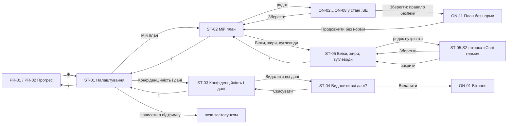

# Налаштування — специфікація (мінімум для MVP)

Статус: **чернетка; обсяг затверджено власником продукту 2026-11-20** (`docs/product/decisions.md` SD-07); норма Б/В/Ж (ST-05) додана 2026-11-23 (SD-13), пороги — пропозиція до перевірки дієтологом (OQ-06). Тексти про конфіденційність і контакти — заглушки до юридичної перевірки (OQ-07).
Пов'язані: [core-calorie-tracking-flow.md](core-calorie-tracking-flow.md) (CT-01, Q44, Q38) · [../features/progress/requirements.md](../features/progress/requirements.md) (PR-01 / PR-02, PR-D26) · [calculation-model.md](calculation-model.md) §4.7 (норма Б/В/Ж) · [onboarding-flow.md](onboarding-flow.md) (ON-01, ON-02…ON-08 у стані .SE, ON-10, ON-11) · [../../product/wireframe-audit.md](../../product/wireframe-audit.md) §9
Обсяг: **входить** — змінити відповіді й отримати перераховану норму, побачити й змінити норму Б/В/Ж (ST-05, SD-13), дізнатися про обробку даних, видалити всі дані, звернутися в підтримку. **Не входить** — акаунт і вхід, підписка, нагадування, одиниці (лише кг / см, Q4 онбордингу), ручне введення норми калорій (Q8 онбордингу; свої грами Б/В/Ж — дозволено, ST-05), вимкнення текстів CT-01, експорт даних.
Платформа: мобільний застосунок, low-fidelity вайрфрейми, 390 × 844. Мова інтерфейсу: українська.

Позначення: **[I]** — висновок автора. `{…}` — значення з розрахунку (приклад «Олена», `onboarding-flow.md` §6).

---

## 1. Сценарії

### 1.1 Основний сценарій — змінити план

| № | Екран | Дія користувача | Результат |
|---|---|---|---|
| 1 | PR-01 / PR-02 Прогрес | ⚙ у заголовку, поруч з ⓘ (ST-D5) | ST-01 |
| 2 | ST-01 Налаштування | «Мій план» | ST-02 |
| 3 | ST-02 Мій план | рядок «Звичайний день» | ON-06.SE (`onboarding-flow.md`) |
| 4 | ON-06.SE | «Багато ходжу» → «Зберегти» | ST-02.S2: норма перерахована, повідомлення «Норму оновлено · {N} ккал» |
| 5 | ST-02 | «‹» → «‹» | ST-01 → PR-01 / PR-02 (звідки відкрито) з новою ціллю; на CT-01 нова ціль теж |

### 1.2 Інші сценарії

| Сценарій | Шлях |
|---|---|
| Видалити всі дані | ST-01 → «Конфіденційність і дані» → ST-03 → «Видалити всі дані» → ST-04 → «Видалити» → ON-01 (перший запуск) |
| Передумати видаляти | ST-04 → «Скасувати» → ST-03 без змін |
| Зміна вмикає правило безпеки | ST-02 → рядок «Здоров'я» → ON-05.SE → позначка «Вагітність» → «Зберегти» → ON-11 → «Продовжити без норми» → ST-02.S3 (без норми); CT-01 — у режимі без норми (Q38) |
| Задати свою норму білків | ST-02 → «Білки, жири, вуглеводи» → ST-05 → «Білки» → ST-05.S2 (шторка) → ввести «120» → «Зберегти» → ST-05.S3 (свої значення, повідомлення «Норму оновлено»); на CT-01 білки показуються з нормою «120 г» (core Q54) |
| Повернути рекомендовані | ST-05.S3 → «Скинути до рекомендованих» → ST-05.S1 |
| Підтримка | ST-01 → «Написати в підтримку» → поштовий клієнт / форма поза застосунком (контакт не задано) |

Діаграма похідна від таблиць Actions; при розбіжності правильні таблиці.

---

## 2. Екрани

### ST-01 Налаштування — type: screen
Goal: знайти, де змінити план або дані. · Entry: ⚙ у заголовку «Прогрес» (PR-01 / PR-02; ST-D5, core Q44). · Main journey: yes

Layout
| # | Region | Elements and visible content | Behaviour |
|---|---|---|---|
| 1 | Status bar | системний | fixed |
| 2 | Header | «‹» · «Налаштування» | fixed |
| 3 | List | рядки «підпис — значення ›»: «Мій план — 1 750 ккал» · «Конфіденційність і дані» · «Написати в підтримку» | scrolls |
| 4 | Footer | сірий текст «Версія {x.y}» | у кінці списку |

Actions
| Element | Gesture | Condition | Result |
|---|---|---|---|
| «Мій план» | tap | — | ST-02 |
| «Конфіденційність і дані» | tap | — | ST-03 |
| «Написати в підтримку» | tap | — | поза застосунком (контакт не задано) |
| «‹» | tap | — | назад на PR-01 / PR-02 (звідки відкрито; ST-D5) |

States
| ID | State | Trigger | Shown as | What differs |
|---|---|---|---|---|
| ST-01.S1 | З нормою | вхід | own frame | — |
| ST-01.V-no-target | Без норми | Q38 | variant | значення рядка «Мій план» — «Без норми» |

### ST-02 Мій план — type: screen
Goal: побачити норму і змінити відповіді, з яких її пораховано. · Entry: ST-01 «Мій план»; повернення зі станів .SE і ON-11. · Main journey: yes

Перевикористовує список ON-10 і стани .SE онбордингу (D11 онбордингу) — нового редактора профілю немає.

Layout
| # | Region | Elements and visible content | Behaviour |
|---|---|---|---|
| 1 | Status bar | системний | fixed |
| 2 | Header | «‹» · «Мій план» | fixed |
| 3 | Target | «Ваша денна норма» · «1 750 ккал» · «щоб худнути приблизно на 0,4 кг на тиждень» | scrolls |
| 4 | Macros row | рядок `WF/Onboarding/Answer Row` «Білки, жири, вуглеводи — Рекомендовані» (або «Свої», якщо хоч один нутрієнт задано вручну); прихований у ST-02.S3 (без норми) | scrolls |
| 5 | Answers list | рядки як на ON-10 (`WF/Onboarding/Answer Row`): «Мета — Схуднути» · «Стать для розрахунку — Жіноча» · «Рік народження — 1992» · «Зріст — 165 см» · «Вага — 78 → 68 кг» · «Здоров'я — Нічого з переліченого» · «Звичайний день — Переважно сиджу · як більшість» · «Тренування — 3–4 рази · помірні · 45 хв» · «Темп — Комфортно» | scrolls |
| 6 | Note | сірий текст «Нова норма діє з сьогодні. Минулі дні порівнюються з ціллю, яка діяла того дня.» | scrolls |

Кнопки «Готово» немає: кожна відповідь зберігається на своєму екрані .SE.

Actions
| Element | Gesture | Condition | Result |
|---|---|---|---|
| рядок відповіді | tap | — | відповідний екран ON-02…ON-08 у стані .SE (таблиця Actions ON-10) |
| «Білки, жири, вуглеводи» | tap | норма є | ST-05 |
| «Зберегти» на .SE | tap | норма змінилася | ST-02.S2 |
| «Зберегти» на .SE | tap | вмикає правило безпеки | ON-11 → «Продовжити без норми» → ST-02.S3 |
| «Зберегти» на .SE | tap | норма не змінилася (напр. лише бажана вага, D6 онбордингу) | ST-02.S1 з оновленим значенням рядка (`onboarding-flow.md` §1.3) |
| «‹» | tap | — | ST-01 |

States
| ID | State | Trigger | Shown as | What differs |
|---|---|---|---|---|
| ST-02.S1 | Норма є | вхід | own frame | — |
| ST-02.S2 | Норму оновлено | «Зберегти» на .SE | own frame | нове число в Target; повідомлення `WF/Toast` «Норму оновлено · {N} ккал» над нижнім краєм, зникає саме (без «Скасувати» — повернути можна тим самим рядком) |
| ST-02.S3 | Без норми | ON-11 «Продовжити без норми» | own frame | Target: «Норма не рахується» · «Ви записуєте їжу без денної норми. Змінити це можна у відповіді «{рядок}».»; рядки відповідей лишаються, рядок «Білки, жири, вуглеводи» прихований (без норми калорій немає й норми Б/В/Ж) |

### ST-05 Білки, жири, вуглеводи — type: screen
Goal: побачити денну норму Б/В/Ж і за бажанням задати свої грами. · Entry: ST-02 «Білки, жири, вуглеводи». · Main journey: no

Норма рахується автоматично з денної норми калорій і ваги (`calculation-model.md` §4.7, SD-13); онбординг не змінюється.

Layout
| # | Region | Elements and visible content | Behaviour |
|---|---|---|---|
| 1 | Status bar | системний | fixed |
| 2 | Header | «‹» · «Білки, жири, вуглеводи» | fixed |
| 3 | Intro | «Рекомендовано з вашої норми 1 750 ккал і ваги 78 кг. Можна задати свої грами.» | scrolls |
| 4 | Macro rows | три рядки `WF/Onboarding/Answer Row`: «Білки — від 65 г · рекомендовано ›» · «Вуглеводи — 197–263 г · рекомендовано ›» · «Жири — 39–68 г · рекомендовано ›»; рядок зі своїм значенням — «120 г · свої ›» | scrolls |
| 5 | Sum | лише якщо є свої значення: сірий рядок «Разом ≈ {Σ} ккал · ваша норма 1 750 ккал» (довідка, без перевірки) | scrolls |
| 6 | Reset | лише якщо є свої значення: текстова кнопка «Скинути до рекомендованих» | scrolls |
| 7 | Note | сірий текст «Орієнтовні значення для здорових дорослих. Якщо у вас є захворювання або особливий раціон, порадьтеся з лікарем.» `[текст до перевірки дієтологом — OQ-06]` | scrolls |

Шторка ST-05.S2 «Свої грами» (`WF/Sheet/Portion` у спрощеному вигляді): заголовок нутрієнта («Білки») · поле «N г» (велике число; цифрова клавіатура, як у шторці позиції Q47) · підпис «Рекомендовано: від 65 г» · основна кнопка «Зберегти» · текстова «Використати рекомендоване» (лише якщо значення своє) · ✕.

Actions
| Element | Gesture | Condition | Result |
|---|---|---|---|
| рядок нутрієнта | tap | — | ST-05.S2 (шторка з полем, клавіатура відкрита) |
| «Зберегти» у шторці | tap | 10 ≤ N ≤ 400 | ST-05.S3; повідомлення `WF/Toast` «Норму оновлено» (без «Скасувати» — як ST-02.S2) |
| «Використати рекомендоване» у шторці | tap | значення своє | цей нутрієнт — знову автоматичний → ST-05.S1 (або S3, якщо інші лишаються своїми) |
| ✕ / свайп униз | tap / swipe | — | ST-05 без змін |
| «Скинути до рекомендованих» | tap | є свої значення | усі три — автоматичні → ST-05.S1; повідомлення «Повернуто рекомендовані» |
| «‹» | tap | — | ST-02 |

States
| ID | State | Trigger | Shown as | What differs |
|---|---|---|---|---|
| ST-05.S1 | Рекомендовані | вхід | own frame | усі три рядки «рекомендовано»; немає рядків Sum і Reset |
| ST-05.S2 | Свої грами (шторка) | tap рядка | own frame | шторка над затемненим ST-05, поле з клавіатурою |
| ST-05.S3 | Є свої значення | «Зберегти» | own frame | рядок «Білки — 120 г · свої»; рядок «Разом ≈ 1 890 ккал · ваша норма 1 750 ккал» (120·4 + 230·4 + 54·9 = 1 886: для автоматичних — середина діапазону, calculation-model §4.7); «Скинути до рекомендованих» |
| ST-05.S4 | Некоректно | N < 10, N > 400 або порожньо | variant on ST-05.S2 | «Зберегти» вимкнена, підказка «Від 10 до 400 г» (межі — заглушка до OQ-06) |

Свої значення не перераховуються, коли змінюється норма калорій (ST-02.S2); автоматичні — перераховуються. Кожен день зберігає норму Б/В/Ж, що діяла того дня.

### ST-03 Конфіденційність і дані — type: screen
Goal: дізнатися, які дані зберігаються, і мати змогу їх видалити. · Entry: ST-01. · Main journey: no

Layout
| # | Region | Elements and visible content | Behaviour |
|---|---|---|---|
| 1 | Status bar | системний | fixed |
| 2 | Header | «‹» · «Конфіденційність і дані» | fixed |
| 3 | Info | підзаголовок «Що ми зберігаємо» · текст `[текст не задано]` · текстове посилання «Політика конфіденційності» | scrolls |
| 4 | Danger action | текстова кнопка «Видалити всі дані» (звичайний колір, без червоного — E11) | scrolls |

Actions
| Element | Gesture | Condition | Result |
|---|---|---|---|
| «Політика конфіденційності» | tap | — | поза застосунком (адреса не задана) |
| «Видалити всі дані» | tap | — | ST-04 |
| «‹» | tap | — | ST-01 |

States
| ID | State | Trigger | Shown as | What differs |
|---|---|---|---|---|
| ST-03.S1 | За замовчуванням | вхід | own frame | — |

### ST-04 Видалити всі дані? — type: dialog
Goal: захистити від випадкової незворотної дії. · Entry: ST-03 «Видалити всі дані». · Main journey: no

Layout
| # | Region | Elements and visible content | Behaviour |
|---|---|---|---|
| 1 | Backdrop | затемнена копія ST-03 | — |
| 2 | Dialog | заголовок «Видалити всі дані?» · текст «Буде видалено всі записи їжі, ваші відповіді й норму. Цю дію не можна скасувати.» · кнопки «Видалити» і «Скасувати» | по центру |

Actions
| Element | Gesture | Condition | Result |
|---|---|---|---|
| «Видалити» | tap | — | усі дані видалено → ON-01 (як перший запуск) |
| «Скасувати» | tap | — | ST-03 без змін |

States
| ID | State | Trigger | Shown as | What differs |
|---|---|---|---|---|
| ST-04.S1 | Питання | вхід | own frame | — |

---

## 3. Компоненти

| Компонент | Де | Примітка |
|---|---|---|
| WF/Onboarding/Answer Row (наявний) | ST-01, ST-02 | підпис · значення · «›» |
| WF/Toast (наявний) | ST-02.S2, ST-05.S3 | без дії |
| WF/Sheet/Portion (наявний, спрощено) | ST-05.S2 | лише поле кількості «г», без одиниць, Б/В/Ж і джерела |
| WF/Button/Primary, WF/Button/Text (наявні) | ST-04, ST-03 | — |
| WF/Icon (наявний) | ⚙ у заголовку PR-01 / PR-02 | — |

Нових компонентів немає **[I]**: налаштування збирається з наявних (ST-05 — теж).

---

## 4. Рішення

| ID | Рішення | Обґрунтування |
|---|---|---|
| ST-D1 | **Мінімальний набір: Мій план · Конфіденційність і дані · Підтримка.** Затверджено власником продукту 2026-11-20 (SD-07) | Змінити норму і видалити дані — потреби людини й вимоги магазинів; решта — поза MVP |
| ST-D2 | **«Мій план» перевикористовує список ON-10 і стани .SE** | Без нового редактора — менше екранів і правил (Simplicity First) |
| ST-D4 | **Видалення — з підтвердженням, без червоного** | Незворотна дія; нейтральна мова й колір (E11–E14) |
| ST-D5 | **Вхід — ⚙ у заголовку «Прогрес»** (PR-01 / PR-02, поруч з ⓘ), не на «Сьогодні» і не третя вкладка (core Q44, PR-D26) | Власник прибрав ⚙ з головного екрана, щоб «Сьогодні» лишався простим; налаштування відкривають рідко, тож вхід поруч з іншою рідкісною дією (ⓘ) достатній. Затверджено 2026-11-21 |
| ST-D6 | **Норма Б/В/Ж — автоматична, свої грами — у «Мій план» → ST-05** (SD-13, core Q54). Автоматична норма з калорій і ваги; людина може замінити будь-який нутрієнт своїм числом; «Скинути до рекомендованих». Без нового кроку онбордингу; без типів харчування (кето тощо). Межі введення 10–400 г і текст примітки — заглушки до OQ-06. Затверджено 2026-11-23 (власник обрав «Автоматична норма + свої грами в налаштуваннях») | Грами без норми людині нічого не кажуть; більшість не знає своїх чисел, тому типово — автоматична норма (Cal AI, Garmin, Noom), а свої грами — для тих, хто знає (Cal AI, Bevel) |

## 5. Відкриті питання

| ID | Питання | За замовчуванням (малюється) |
|---|---|---|
| ST-Q1 | Тексти «Що ми зберігаємо», політика, контакт підтримки (OQ-07) | `[текст не задано]` |
| ST-Q2 | Якщо дані зберігаються на сервері (OQ-04) — стани «Видаляємо…» і «Не вдалося видалити» | Не малюються (видалення миттєве) |
| ST-Q3 | Чи потрібен експорт даних перед видаленням | Ні (поза MVP) |
| ST-Q4 | Пороги норми Б/В/Ж, межі своїх значень і текст примітки ST-05 (OQ-06) | `calculation-model.md` §4.7; 10–400 г; текст із заглушкою |
